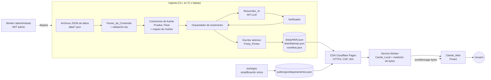
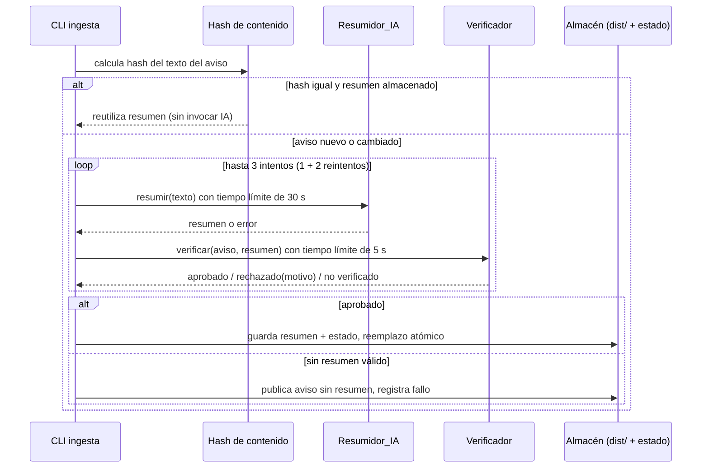
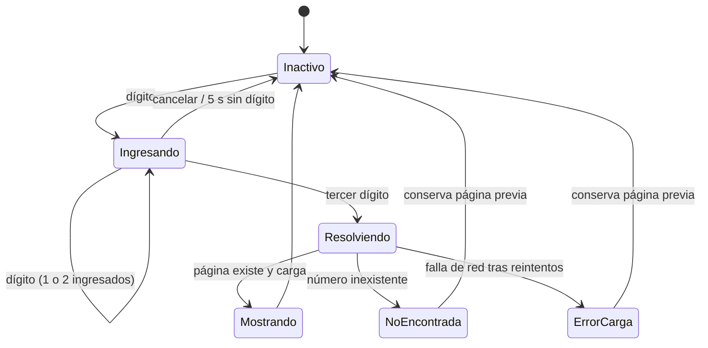
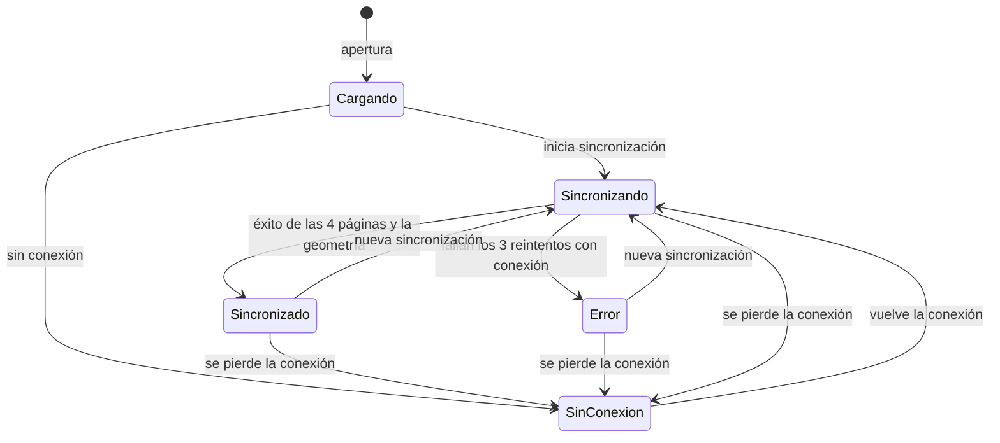

# Design Document

## Overview

Teletexto 2.0 es una PWA estática, servida desde una CDN, que muestra páginas de información pública identificadas por números de tres dígitos. El MVP tiene cuatro páginas: 100 (portada con reloj, estado de sincronización y menú), 101 (alertas de SENAMHI e INDECI), 200 (precios agrícolas de MIDAGRI) y 400 (mapa interactivo de riesgos climáticos por departamento). El contenido se precalcula como archivos JSON estáticos. Los resúmenes con IA se generan una sola vez, al publicar un aviso, y pasan por un verificador determinista antes de publicarse. Todas las páginas muestran en el pie el consumo de datos de la propia aplicación.

Objetivos de diseño, en orden de prioridad:

1. **Veracidad**: ningún resumen llega al usuario si el Verificador no lo aprueba (Requisitos 11 y 12). Ningún departamento recibe un nivel de riesgo que no provenga de una alerta vigente (Requisito 4).
2. **Funcionamiento con red mala o sin red**: carga inicial de 150 KB o menos, páginas de 20 KB o menos, geometría del mapa de 80 KB o menos, service worker con caché local (Requisitos 7 y 14).
3. **Costo y alcance**: dos personas, 15 días, USD 20 al mes o menos (Requisitos 16 y 19).
4. **Crecimiento posterior**: agregar páginas y fuentes con datos y configuración, no con código (Requisito 17).

### Decisiones tecnológicas y compromisos

| Decisión | Elección | Alternativas descartadas | Razón y compromiso |
|---|---|---|---|
| Cliente | PWA con **Preact + TypeScript + Vite** (sin cambios) | React (unos 40 KB); JS plano | Preact pesa unos 4 KB y permite componentes dentro del presupuesto de 150 KB. Menos ecosistema que React, suficiente para el MVP. |
| Estilo | CSS propio, fuente monoespaciada del sistema (sin cambios) | Frameworks CSS; fuentes web | Evita descargar fuentes. El aspecto teletexto se logra con cuadrícula CSS y paleta fija. |
| Mapa | **SVG en línea renderizado por Preact** a partir de un archivo estático de rutas SVG pre-simplificadas (`/geo/departamentos.json`) | Leaflet (unos 40 KB comprimidos más teselas de red); MapLibre GL (unos 200 KB y teselas); GeoJSON crudo con proyección en el cliente; TopoJSON con librería | Una librería de mapas excede o consume casi todo el presupuesto de 150 KB, necesita teselas de red (inútiles sin conexión) y no hace falta: el mapa solo tiene 25 polígonos sin zoom ni teselas. Las rutas se proyectan y simplifican en una herramienta de build, de modo que el cliente solo pinta `<path>`. El compromiso es que no hay zoom continuo. En pantallas menores a 600 px se ofrece ampliación por pellizco o escala del contenedor y la vista de lista. |
| Servicio_Contenido | **Archivos JSON estáticos** generados en build y servidos por CDN (`/p/100.json`, `/d/alertas.json`, etc.) (sin cambios) | API con servidor siempre activo | Cumple los Requisitos 16.2 y 17.5 (sin cómputo ni estado por solicitud). Los cambios se publican por build, no al instante. |
| Hosting y CDN | **Cloudflare Pages** (sin cambios) | Netlify, Vercel, S3 + CloudFront | Nivel gratuito, HTTPS automático, `_headers` para CSP y HSTS, ETag y 304. Hay dependencia de un proveedor, pero los archivos son portables. |
| Ingesta | **CLI Node** (`tools/ingest`) que ejecuta Parser, mapeo de niveles, Resumidor y Verificador y escribe JSON a `dist/` (sin cambios) | Función serverless por solicitud | Corre en CI o en la laptop. No hay cómputo en la consulta. Reemplaza el panel de administración (fuera de alcance). |
| Preparación de geometría | **Herramienta de build de una sola vez** (`tools/geo`): mapshaper (CLI, licencia MIT) para simplificar y un script propio de unas 60 líneas para proyectar y emitir rutas SVG. El resultado se versiona en el repositorio. | Simplificar en cada build; simplificar en el cliente; dibujar los polígonos a mano | Se ejecuta pocas veces (la geometría casi no cambia), así que no añade tiempo de build ni dependencias al cliente. Es la única herramienta nueva y no se incluye en el bundle. |
| Rate limit y escritura | **Cloudflare WAF Rate Limiting** (60 solicitudes por 60 s por IP) y **Worker mínimo** `/admin/*` con JWT firmado (sin cambios) | Servidor propio | El Worker solo atiende recargas de contenido. |
| IA | LLM por API invocado **solo desde el CLI de ingesta** (sin cambios) | Invocar al LLM desde el navegador | La clave nunca está en el cliente (Requisitos 15.4 y 15.5). |
| Verificador | **Determinista** (extractor de Datos_Críticos con expresiones regulares y léxicos), sin LLM (sin cambios) | Un segundo LLM como juez | Reproducible, probable con propiedades y sin costo. Solo detecta los tipos de datos que sabe extraer; ante la duda rechaza. |
| Caché offline | **Service worker escrito a mano** (unos 200 líneas) con Cache Storage e IndexedDB | Workbox | Menos peso y control total de reintentos, fecha de sincronización y medición de bytes. |
| Medición de datos | **Resource Timing en la página más mensajes del service worker**, con acumulador puro (ver Indicador_de_Datos) | Servicios externos de medición; estimaciones | Es lo único que el navegador permite medir. No se simulan valores. |
| Pruebas | **Vitest + fast-check**, Playwright + axe-core, Lighthouse CI (sin cambios) | Jest | Misma cadena que Vite. |
| Validación de esquema | **Ajv** con JSON Schema (sin cambios) | Validación manual | Mensajes con campo y regla (Requisito 13.3). |

### Geometría del mapa: fuente, licencia y simplificación (supuesto por confirmar)

El diseño **no afirma** que la geometría sea oficial. La elección de la fuente es un supuesto que el Equipo debe confirmar antes del día 4:

- **Candidata preferida**: límites departamentales del INEI o del IGN (Perú), obtenidos del geoportal oficial. Se debe verificar la licencia de uso y la atribución que exigen antes de versionar el archivo.
- **Alternativas**: Natural Earth (dominio público, nivel de detalle suficiente para un mapa de departamentos, pero su división puede no coincidir exactamente con los 25 Departamentos del Requisito 4.1 y habría que fusionar o renombrar unidades); GADM (tiene restricciones de uso que podrían no ser compatibles con el proyecto).
- **Tabla de códigos**: se usa la codificación de departamentos del UBIGEO del INEI (01 a 25, con Callao como 07). También es un supuesto por confirmar contra la fuente elegida. Lima se representa como un solo Departamento que incluye la provincia de Lima, y el Callao como otro.
- **Simplificación**: `tools/geo` (1) lee la fuente, (2) fusiona o agrupa hasta tener exactamente 25 unidades, (3) simplifica con mapshaper conservando topología hasta que el archivo comprimido quede por debajo de 80 KB, con un margen objetivo de 50 KB, (4) proyecta con una proyección equirrectangular simple (suficiente para Perú) a un `viewBox` fijo y (5) emite rutas SVG con coordenadas de un decimal. El script falla si el resultado no tiene exactamente los 25 códigos de la tabla o supera 80 KB comprimidos.
- La atribución y la licencia se muestran en la vista de Página 400 cuando la fuente lo exija.

## Architecture



### Fuente única de alertas para las Páginas 101 y 400

Las Alertas_de_Riesgo viven en **un solo archivo**, `/d/alertas.json`. Las Páginas 101 y 400 (`/p/101.json`, `/p/400.json`) contienen su título, tipo y Metadatos_de_Página, y declaran `datos: "alertas"`. El cliente obtiene las alertas de ese archivo y calcula las dos vistas con la misma función `alertasVigentes(dataset, ahora)`. Así el nivel, la vigencia y los Departamentos de una alerta son idénticos en ambas páginas por construcción (Requisitos 2.8, 4.13).

- Los Metadatos de 101 y 400 se generan en build desde el mismo dataset, con las mismas fechas.
- El service worker sincroniza `/p/101.json`, `/p/400.json` y `/d/alertas.json` como una unidad: la sincronización de 101 o de 400 solo se registra como exitosa si también se obtuvo `/d/alertas.json`. Ambas páginas comparten el mismo `syncedAt`.
- `/d/alertas.json` cuenta contra el límite de 20 KB comprimidos del Requisito 14.3 (máximo 50 alertas vigentes más las vencidas aún publicadas). Un script de CI lo verifica.
- Se descartó duplicar las alertas dentro de cada archivo de página porque dos versiones en caché con fechas distintas podrían mostrar datos inconsistentes.

### Flujo de publicación de un aviso



### Flujo de navegación en el cliente



### Estado de sincronización de la Portada



### Decisiones clave

- **Un archivo por página y un dataset de alertas**: permite validación de caché por archivo (ETag, 304 con cuerpo vacío) y sincronización independiente (Requisitos 7.6, 14.6).
- **Metadatos dentro de cada archivo**: página y metadatos en un solo archivo hacen atómico el almacenamiento (Requisito 9.6). El reemplazo del conjunto se hace escribiendo en `dist.tmp/` y renombrando (Requisito 13.2).
- **Fechas en UTC ISO 8601 en el servidor, hora de Perú solo en el cliente**: Perú no usa horario de verano, por lo que el desfase fijo UTC-5 es seguro (Requisito 9.2). El reloj de la Portada y la vigencia de las alertas usan una función `ahora()` inyectable, nunca `Date.now()` directo.
- **Sin estado en el servidor**: toda respuesta es un archivo estático (Requisitos 17.5, 17.6).
- **Etiqueta de prueba como dato**: cada registro lleva `esDatoDePrueba` y el cliente decide por registro (Requisito 10).
- **Nunca se asigna un nivel por defecto**: el parser rechaza alertas sin nivel válido y el cliente deja a los Departamentos sin alertas vigentes en Estilo_Neutro (Requisitos 4.5, 13.8).
- **Vigencia calculada en el cliente con el reloj del dispositivo**: una alerta vencida deja de mostrarse como vigente aunque el contenido venga de la caché (Requisito 4.6). El compromiso es que un reloj mal configurado en el dispositivo altera la vigencia; se acepta porque no hay otra referencia sin conexión.
- **Pantalla de carga con CSS que se oculta sola**: el marcado de la pantalla de carga vive en `index.html` sin scripts ni estilos en línea (la CSP los prohíbe), su CSS está en un archivo pequeño que bloquea el render, y una animación CSS la oculta a los 1.5 s aunque falle el JavaScript (Requisitos 1.9 a 1.12).

## Components and Interfaces

### Cliente_Web (`apps/web`)

| Módulo | Responsabilidad | Interfaz principal |
|---|---|---|
| `shell/splash` | Pantalla de carga (marcado en `index.html` y `splash.css`) | Sin JS propio obligatorio. El módulo principal añade la clase `listo` cuando el contenido de la Portada está visible. |
| `shell/reloj` | Reloj de la Portada | `formatLimaConSegundos(epochMs) -> "DD/MM/AAAA HH:mm:ss"` (puro). `useReloj(ahora)` programa un tick alineado al siguiente segundo y recalcula desde `ahora()`. |
| `sync/estadoSync` | Estado de sincronización (reducer puro) | `reducir(estado, evento) -> estado` con eventos `abrir`, `contenidoListo`, `syncInicia`, `syncOk(at)`, `syncFalla`, `offline`, `online`. El estado es `{valor: "Cargando"\|"Sincronizando"\|"Sincronizado"\|"Error"\|"Sin conexión", ultimaSyncOk?: string}`. |
| `sync/frescura` | Desactualización (pura) | `estadoFrescura(syncedAt \| undefined, ahora, umbralMs) -> "nunca" \| "vigente" \| "desactualizada"`. Los umbrales vienen de la configuración de cada página (6 h para 101 y 400, 24 h para 100 y 200). |
| `sync/conexion` | Estado "En línea" / "Sin conexión" | Escucha `online` y `offline` y emite eventos al reducer. |
| `nav/entryBuffer` | Máquina de estados de dígitos (pura) | `push(state, digit, now)`, `cancel(state)`, `tick(state, now)`, `display(state)` (por ejemplo `"1_ _"`). |
| `nav/router` | Número a URL y viceversa | `pageToUrl(n)`, `urlToPage(path)`, `isValidPageNumber(n)` |
| `nav/history` | Historial de sesión | `visit(h, n)`, `back(h)` (sin cambio si no hay anterior) |
| `data/pageLoader` | Carga de página con reintentos y respaldo | `loadPage(n, deps) -> Result<Page, LoadError>`; esperas de 1, 2 y 4 s |
| `data/retry` | Política de reintentos (pura) | `backoffSchedule(attempts) -> number[]` |
| `format/dates` | Formato de fechas | `formatLima(iso) -> "DD/MM/AAAA HH:mm"` o `"No disponible"` |
| `format/money` | Formato de moneda | `formatSoles(centimos) -> "S/ 2.50"` |
| `format/sanitize` | Escape de texto externo | `escapeText(s)` |
| `pages/Portada` | Menú de tres entradas, reloj, estado de sincronización, etiqueta de prueba | Recibe `Page`, el estado del reducer y `ahora` |
| `pages/Alertas` | Página 101 | Usa `alertasVigentes` y `sortAlerts` |
| `pages/Precios` | Página 200 | `filterByProduct(rows, p)`, `paginate(rows, 20)` |
| `pages/Mapa` | Página 400, componente `MapaRiesgos` | Ver abajo |
| `risk/alertas` | Lógica pura de alertas | `esVigente(alerta, ahora)`, `alertasVigentes(dataset, ahora)`, `riesgoPorDepartamento(alertas, ahora)`, `detalleDepartamento(codigo, alertas, ahora)`, `sortAlerts(a[])`, `mergeSources(snapshotSenamhi, snapshotIndeci)` |
| `risk/departamentos` | Tabla de datos de los 25 Departamentos | `DEPARTAMENTOS: {codigo, nombre}[]` (datos, no lógica) |
| `risk/mapNav` | Navegación entre Departamentos (pura) | `ordenRecorrido(geometria) -> codigo[]`, `mover(geometria, actual, direccion) -> codigo` |
| `meter/datos` | Indicador_de_Datos | `acumular(estado, muestra) -> estado`, `formatMB(bytes) -> "X.XX MB"`, `textoIndicador(estado, capacidades) -> string[]` (puros), más un adaptador pequeño que lee Resource Timing y los mensajes del service worker |
| `a11y/contrast` | Contraste WCAG | `contrastRatio(fg, bg)` (usado en pruebas de la paleta, la leyenda y los bordes) |

El Cliente_Web solo consume `/p/NNN.json`, `/d/alertas.json`, `/geo/departamentos.json` y `/manifest.json` del mismo origen. No hay llamada alguna al Resumidor_IA.

#### Portada: reloj, pantalla de carga y estado

- **Reloj**: `formatLimaConSegundos` suma el desfase fijo de -5 h al instante UTC y formatea con campos UTC, sin depender de `Intl` ni de la zona del dispositivo. El componente calcula el tiempo restante hasta el siguiente segundo y programa el siguiente tick desde `ahora()`, así la diferencia máxima respecto del reloj del dispositivo es menor a 1 s y no se acumula deriva (Requisitos 1.7, 1.8). Solo se ejecuta mientras la Portada está visible.
- **Pantalla de carga**: se compone de un `<div>` con el nombre "Teletexto 2.0" y un logotipo SVG en línea mínimo dentro de `index.html`, y de `splash.css`. Peso objetivo: 5 KB comprimidos o menos entre marcado y CSS, sin imágenes rasterizadas ni librerías (Requisito 1.11). Una animación CSS con retardo de 1.5 s la oculta (`visibility: hidden`) aunque el JavaScript no haya cargado. Cuando la Portada ya tiene contenido, el módulo principal añade `listo` y la oculta antes. Si el contenido aún no llega a los 1.5 s, la Portada se muestra con el estado "Cargando" (Requisito 1.10). Con `prefers-reduced-motion: reduce`, la pantalla no tiene animación de entrada ni de salida, solo el retardo de ocultamiento.
- **Estado de sincronización**: el reducer garantiza que `Sin conexión` domina mientras no hay conexión, que `ultimaSyncOk` solo cambia con `syncOk` y que `Error` conserva la última fecha exitosa (Requisitos 1.13 a 1.18). Cada valor se muestra con texto e icono propios y un nombre accesible.

#### Frescura y estado de conexión

`estadoFrescura` devuelve `"nunca"` si no hay `syncedAt` (se muestra "Nunca sincronizada" y ninguna fecha estimada), `"desactualizada"` si `ahora - syncedAt` es mayor que el umbral, y `"vigente"` en otro caso (Requisitos 7.9 a 7.11). El aviso "Información desactualizada" se muestra con texto, icono y nombre accesible, con y sin conexión. Se retira solo cuando el usuario vuelve a solicitar la página tras una sincronización exitosa, nunca mientras la lee (Requisito 7.12). El pie de todas las páginas muestra "En línea" o "Sin conexión" con icono y la fecha de la última sincronización de la página en `DD/MM/AAAA HH:mm`.

#### Componente MapaRiesgos (Página 400)

- **Render**: un `<svg>` con `viewBox` fijo, un `<path>` por Departamento tomado de `/geo/departamentos.json`, un `<g>` por Departamento con `role="button"`, `tabindex` (patrón de foco itinerante: un solo Departamento con `tabindex=0`) y `aria-label` con "Nombre, Nivel_de_Riesgo" o "Nombre, Sin información disponible" (Requisito 18.8). Los cuatro niveles usan colores y **patrones de relleno SVG** (`<pattern>`) distintos, y el Estilo_Neutro usa un relleno y un trazo distintos a los de los cuatro niveles. La paleta se elige para que el contraste entre colores y patrones adyacentes y entre cada color y su borde sea de 3:1 o más (Requisito 18.10).
- **Leyenda**: cinco entradas (cuatro niveles y Estilo_Neutro), cada una con color, texto, patrón e icono (Requisito 4.3).
- **Selección y teclado**: clic, toque, Enter o la tecla de confirmación seleccionan un Departamento. Las teclas direccionales llaman a `mover`, que elige el Departamento más cercano en esa dirección según los centroides de la geometría y, si no hay ninguno, avanza o retrocede en `ordenRecorrido`, de modo que siempre se pueda llegar a los 25. Tab recorre `ordenRecorrido`. El foco muestra un trazo de 2 px o más con contraste de 3:1 o más (Requisitos 4.10, 6.6, 18.3).
- **Panel de detalle**: muestra el nombre del Departamento y sus alertas vigentes (tipo de riesgo, nivel, inicio y fin de vigencia, actualización, fuente, enlace o referencia) en menos de 1 s, ordenadas por nivel descendente y, a igual nivel, por actualización descendente. Sin alertas vigentes muestra el texto exacto "Sin información disponible". Si las alertas son Dato_de_Prueba, la primera línea del detalle es "DATOS DE PRUEBA - NO OFICIAL" (Requisitos 4.7 a 4.9, 4.20, 10.7).
- **Alternativa en lista**: una tabla accesible con los 25 Departamentos, su nivel en texto (o "Sin información disponible") y su número de alertas vigentes, con filas operables por teclado y control remoto y áreas táctiles de 44 x 44 px o más. Si `/geo/departamentos.json` no carga, la Página 400 muestra esta tabla con un aviso de que el mapa no está disponible y conserva las alertas ya obtenidas (Requisitos 4.11, 4.12, 4.18).
- **Pantallas pequeñas**: desde 320 px el SVG se ajusta al ancho sin desplazamiento horizontal. Por debajo de 600 px se permite ampliar el mapa con escala del contenedor y se destaca el acceso a la tabla (Requisito 4.18).
- **Sin conexión**: si la página 400, el dataset y la geometría están en la Caché_Local, el mapa y el detalle se muestran en 1 s o menos (Requisito 4.19).

### Indicador_de_Datos (`meter/datos`)

Muestra el pie "Datos usados por esta aplicación en esta sesión" con los MB descargados, los MB enviados o "Enviados: No disponible", y el texto "No incluye otras aplicaciones ni el consumo total de Internet del dispositivo". El contador existe solo en la memoria del cliente, inicia en 0.00 MB al abrir la sesión, no se guarda ni se envía y el módulo no hace solicitudes de red (Requisitos 8.1, 8.9, 8.11, 8.12, 15.11).

**Qué se puede medir.** Solo se usan datos que el navegador expone:

| Dato | Fuente | Alcance y límites |
|---|---|---|
| Bytes descargados por solicitudes de la página no atendidas por el service worker (primera carga, antes de que el service worker controle la página) | `PerformanceResourceTiming.transferSize` (incluye cabeceras de respuesta) de entradas con `workerStart === 0`. Es el mismo origen, así que no hay problema de `Timing-Allow-Origin`. | Se usa un `PerformanceObserver` con `buffered: true`. Las entradas con `transferSize === 0` (caché HTTP o del navegador) no se cuentan. |
| Bytes descargados por solicitudes atendidas por el service worker | El service worker mide cada respuesta que obtiene de la red y lo informa a la página con `postMessage`. | Las entradas de la página con `workerStart > 0` se ignoran para no contar dos veces. Un acierto de Cache Storage reporta `transferSize` 0 y **no** se cuenta como descarga. |
| Bytes enviados | **El navegador no los expone.** No hay API que dé el tamaño de las cabeceras de solicitud. | Ver más abajo. |

**Mecanismo en el service worker.** Las solicitudes que el service worker hace por sí mismo (sincronización en segundo plano) pueden no aparecer en las entradas de rendimiento de la página. Para cada respuesta que viene de la red, el service worker determina los bytes en este orden y los informa a la página:

1. Entrada de Resource Timing del propio service worker, si el navegador la ofrece: `encodedBodySize` más un `transferSize` si es mayor que 0.
2. Cabecera `Content-Length`, que corresponde al cuerpo codificado en la red.
3. Conteo de los bytes del cuerpo recorrido con una copia de la respuesta (`clone()`), que mide el cuerpo ya decodificado.

El mensaje lleva `{ tipo: "bytes", descargados: n }` y solo se envía al cliente que originó la solicitud (`clientId` o `resultingClientId`), de modo que dos pestañas no se sumen entre sí. En las sincronizaciones lanzadas por la página, esta pasa su `clientId` al service worker. Si una sincronización ocurre sin ninguna ventana abierta, esos bytes no pertenecen a la Sesión y no se informan.

**Solicitudes fallidas o canceladas.** El conteo por copia de respuesta suma los fragmentos recibidos hasta el error o la cancelación y los informa en un bloque `finally`. El Indicador conserva el total sin mostrar errores (Requisito 8.15). Si no hay medida, no se suma nada.

**Bytes enviados.** La aplicación solo hace solicitudes GET sin cuerpo, y el navegador no expone el tamaño de las cabeceras que añade. Por eso en el MVP la detección de capacidades devuelve "enviados no medibles" y se muestra "Enviados: No disponible", más el texto visible de que solo se muestra lo que el navegador puede medir (Requisito 8.6). **No se estima** a partir de valores supuestos. Si en el futuro un navegador expone ese dato, `acumular` ya acepta `muestra.enviados` y el texto cambia a "Enviados" con su valor (Requisito 8.5). Si tampoco hay descargas medibles, se muestra "No disponible" sin número (Requisito 8.7).

**Límites y márgenes de error (documentados en la interfaz con un texto breve y en el README):**

- El valor es una aproximación. Con la medida 1 o 2 (cuerpo codificado), subestima entre un 1 % y un 5 % porque no incluye TLS ni parte de las cabeceras en el camino 2. Con la medida 3 (cuerpo decodificado) puede sobreestimar hasta varias veces en texto comprimido. Se prioriza siempre la medida 1, luego la 2 y solo en último caso la 3.
- No cuenta las solicitudes de otras pestañas, de otras aplicaciones ni del propio navegador (DNS, TLS, actualizaciones).
- Si el service worker aún no controla la página, la primera visita solo cuenta las entradas de la página.
- El texto visible dice "Medido a partir de las respuestas de la aplicación; puede diferir del consumo real de red".

**Formato y frecuencia.** `formatMB(bytes)` divide entre 1 000 000, redondea al múltiplo de 0.01 más cercano con el punto medio hacia arriba, y muestra siempre dos decimales ("X.XX MB"). Usa aritmética entera sobre centésimas (`floor((bytes * 100 + 500000) / 1000000)`) para evitar errores de coma flotante. Las muestras se acumulan en memoria y la pantalla se refresca como máximo una vez por segundo, siempre dentro de los 5 s posteriores al fin de una solicitud (Requisito 8.10). El pie no usa regiones `aria-live` (no anuncia sus cambios) pero expone su texto completo a los lectores de pantalla (Requisito 8.14).

**Peso.** El módulo y su CSS suman 2 KB comprimidos o menos, sin librerías. Un script de CI mide el tamaño (Requisito 8.13).

### Service Worker (`apps/web/sw.ts`)

- `install`: precaché de la aplicación base (HTML, JS, CSS, `splash.css`). La geometría **no** se precachea en la instalación.
- `sync(paginas)`: al detectar conexión (`online`) o al iniciar con red, descarga 100, 101, 200 y 400 (con `/d/alertas.json`, ver arriba) y `/geo/departamentos.json` con tiempo límite de 10 s por solicitud y en un plazo máximo de 30 s en total (Requisito 7.1). Guarda cada página con `{ contenido, syncedAt }`. En fallo, **no toca** la versión anterior y reintenta hasta 3 veces con 30 s o más entre intentos (Requisito 7.6). Tras el tercer fallo deja `syncedAt` intacto y emite el aviso "no se pudo actualizar". Emite al cliente los eventos `syncInicia`, `syncOk(at)` y `syncFalla` para el reducer.
- `fetch`: política *cache-first con revalidación* para páginas. Sin red responde desde caché en menos de 1 s. La actualización en segundo plano **no reemplaza** lo que se está mostrando; el cliente ve el contenido nuevo en la siguiente navegación (Requisito 7.5). Cada respuesta que viene de la red se mide como se describe en el Indicador_de_Datos.
- Contrato con la interfaz:
  - `getCacheStatus(n) -> {cached: boolean, syncedAt?: string}` para n en {100, 101, 200, 400}.
  - `getGeoStatus() -> {cached: boolean, syncedAt?: string}`.
  - `listCachedPages() -> number[]`.
  - `getUmbral(n) -> number` leído del manifiesto, para `estadoFrescura`.
  - Mensajes al cliente: `{tipo: "sync", evento: "inicia" | "ok" | "falla", at?: string}` y `{tipo: "bytes", descargados: number}`.

### Servicio_Contenido (generado en build, `tools/ingest`)

```ts
interface ConectorFuente {
  id: "senamhi" | "indeci" | "midagri";
  leer(opts: { timeoutMs: number }): Promise<RegistroCrudo[]>; // rechaza si supera 10 s
}
```

- `ConectorPrueba` (MVP) lee `data/prueba/*.json`. `ConectorReal` (futuro) implementa la misma interfaz. El cliente no cambia (Requisitos 4.15, 13.6).
- **Capa de mapeo de niveles**: cada conector de alertas convierte la escala oficial de su fuente en el `NivelRiesgo` normalizado mediante una tabla de datos (`data/mapeo-niveles.json`), y conserva el texto oficial y si es el nivel máximo de esa escala. Un valor oficial que no está en la tabla produce un error de conector y la alerta se rechaza. **No existe un nivel por defecto.** La tabla inicial es un supuesto por confirmar con las escalas publicadas por SENAMHI e INDECI: verde = Bajo, amarillo = Moderado, naranja = Alto, rojo = Muy alto.
- Si un conector falla o excede 10 s: se registra `{fuente, error}`, se conserva el último contenido válido y se devuelve el error a quien lanzó la carga (Requisito 13.7).

```ts
// Parser_de_Contenido y Pretty_Printer
parsePage(text: string, fileName: string): Result<Page, ParseError>;
parseAlertas(text: string, fileName: string): Result<DatasetAlertas, ParseError>;
printPage(page: Page): string; // JSON UTF-8, claves en orden fijo, sangría de 2 espacios, "\n" final
printAlertas(d: DatasetAlertas): string;
loadAll(files: FileInput[]): Result<ContentSet, ParseError[]>; // todo o nada
validatePageConfig(cfgs: PageConfig[]): Result<void, ConfigError>; // 100..999, sin duplicados
```

`ParseError = { archivo: string; campo?: string; causa?: string; regla: string }`. Se rechaza un archivo vacío, mayor a 1 MB, que no sea JSON o que incumpla el esquema. `parseAlertas` rechaza todo el archivo si una alerta carece de Departamento válido (uno de los 25 códigos), de nivel válido, de fecha de inicio o de fin, o tiene fin anterior a inicio, y no asigna ningún nivel por defecto (Requisito 13.8).

### Orquestador de resúmenes

```ts
interface Resumidor { resumir(aviso: AvisoOficial, signal: AbortSignal): Promise<string>; }
interface Verificador { verificar(aviso: AvisoOficial, resumen: string): ResultadoVerificacion; }

type ResultadoVerificacion =
  | { estado: "aprobado" }
  | { estado: "rechazado"; motivo: MotivoRechazo }
  | { estado: "no_verificado"; motivo: string };

function publicarResumen(aviso, previo: ResumenGuardado | undefined, deps): ResumenGuardado | undefined;
```

Reglas del orquestador:

1. Si `hashTexto(aviso)` coincide con el `hashFuente` del resumen guardado, **no invoca** al Resumidor (Requisitos 11.5, 16.4).
2. Hasta 1 intento inicial más 2 reintentos, con tiempo límite de 30 s por intento (Requisitos 11.6, 16.5).
3. Un intento es válido si el resumen tiene entre 1 y 60 palabras **y** el Verificador devuelve `aprobado`.
4. Si ningún intento es válido: se publica el aviso sin resumen. El resumen anterior solo se conserva si el texto del aviso no cambió. Si el texto cambió, el resumen anterior ya no corresponde y se omite. Se registra el fallo y no se vuelve a invocar hasta la próxima actualización.
5. Si el servicio de IA no responde en 10 s o devuelve error, se aplica la misma política y el registro lleva el estado "no verificado" con el motivo "servicio de IA no disponible" (Requisito 12.6).

### Verificador (`packages/verifier`)

Extrae Datos_Críticos de un texto como conjuntos normalizados:

```ts
type DatoCritico =
  | { tipo: "cifra"; valor: string; unidad?: string }
  | { tipo: "fecha"; valor: string }        // ISO "AAAA-MM-DD"
  | { tipo: "hora"; valor: string }         // "HH:mm"
  | { tipo: "lugar"; valor: string }        // normalizado, del gazetteer (incluye los 25 Departamentos)
  | { tipo: "nivel"; valor: string };       // del léxico de niveles de alerta

extraerCriticos(texto: string): DatoCritico[];
```

Reglas:

- **Añadidos**: todo dato del resumen debe estar en el conjunto del aviso. Si no, se rechaza con motivo `añadido:<tipo>`.
- **Modificados**: una cifra o fecha del resumen con el mismo contexto que una del aviso pero otro valor, unidad, signo, día, mes o año se rechaza con `modificado:<tipo>`.
- **Omisiones**: cada recomendación del aviso tiene una `clave` canónica y una lista de `frases` aceptadas, normalizadas. El resumen debe contener al menos una frase de cada recomendación. Si falta alguna, se rechaza con `omision:recomendacion`.
- **Plazo**: el límite es 5 s. Si se excede o lanza error, devuelve `no_verificado`.
- **Política ante la duda**: un token numérico que el extractor no interpreta se trata como cifra y debe aparecer igual en el aviso.

El registro de verificación se guarda como `{ estado, motivo?(≤500), verificadoEn (UTC, segundos) }`.

### Worker de administración (`workers/admin`)

Único punto de escritura. `POST /admin/reload` exige `Authorization: Bearer <JWT>` con `rol=admin` y `exp` vigente. Sin credencial o con credencial inválida responde 401. Con rol distinto de admin responde 403. En ambos casos no cambia nada y registra `{timestamp, ip, recurso}`. Si es válida, dispara el workflow de ingesta. Los secretos viven en variables de entorno del CI y del Worker (Requisito 15.4).

### Cabeceras de seguridad (`public/_headers`)

```
/*
  Content-Security-Policy: default-src 'self'; script-src 'self'; style-src 'self'; img-src 'self' data:; connect-src 'self'; frame-ancestors 'none'; base-uri 'none'
  X-Content-Type-Options: nosniff
  X-Frame-Options: DENY
  Strict-Transport-Security: max-age=63072000; includeSubDomains
```

La CSP no cambia por el mapa ni por la pantalla de carga: el SVG del mapa se inserta como elementos del DOM y usa atributos de presentación y clases, no `style=` en línea. La redirección HTTP a HTTPS se activa con "Always Use HTTPS". El rate limit de 60/60 s devuelve 429 con `Retry-After`.

## Data Models

### Esquema de página (JSON Schema, resumido)

```json
{
  "$id": "teletexto/page.schema.json",
  "type": "object",
  "required": ["numero", "titulo", "tipo", "metadatos", "esDatoDePrueba"],
  "additionalProperties": false,
  "properties": {
    "numero": { "type": "integer", "minimum": 100, "maximum": 999 },
    "titulo": { "type": "string", "minLength": 1, "maxLength": 40 },
    "tipo": { "enum": ["portada", "alertas", "precios", "mapa"] },
    "esDatoDePrueba": { "type": "boolean" },
    "datos": { "enum": ["alertas"] },
    "umbralHoras": { "type": "integer", "minimum": 1 },
    "metadatos": {
      "type": "object",
      "required": ["fuente", "publicadoEn", "actualizadoEn"],
      "properties": {
        "fuente": { "enum": ["SENAMHI", "INDECI", "MIDAGRI", "VARIAS"] },
        "publicadoEn": { "type": "string", "format": "date-time" },
        "actualizadoEn": { "type": "string", "format": "date-time" }
      }
    },
    "registros": { "type": "array", "items": { "oneOf": [
      { "$ref": "#/$defs/entradaMenu" }, { "$ref": "#/$defs/precio" } ] } }
  }
}
```

Las páginas de tipo `alertas` y `mapa` no llevan `registros`: declaran `datos: "alertas"` y el contenido está en `/d/alertas.json`, que tiene su propio esquema (`alertas.schema.json`).

### Tipos TypeScript

```ts
type PageNumber = number; // entero 100..999

interface Metadatos { fuente: Fuente | "VARIAS"; publicadoEn: string; actualizadoEn: string } // UTC ISO 8601

interface Page {
  numero: PageNumber; titulo: string; tipo: "portada" | "alertas" | "precios" | "mapa";
  esDatoDePrueba: boolean;           // nunca nulo; ausente o inválido => true al cargar
  umbralHoras: number;               // 6 para 101 y 400; 24 para 100 y 200
  metadatos: Metadatos;
  datos?: "alertas";                 // 101 y 400 leen /d/alertas.json
  registros?: Registro[];            // 100 y 200
}

interface Base { id: string; esDatoDePrueba: boolean }   // por registro (Requisitos 10.2, 10.6)

interface EntradaMenu extends Base { numero: PageNumber; nombre: string /* ≤40 */ }

interface Precio extends Base {
  producto: string; mercado: string; unidad: string;
  precioCentimos: number | null;  // entero en céntimos; null => "Sin dato"
  fecha: string;
}
```

La Portada tiene exactamente tres `EntradaMenu`, para las Páginas 101, 200 y 400.

### Alertas de riesgo (fuente única de las Páginas 101 y 400)

```ts
type CodigoDepartamento =
  "01"|"02"|"03"|"04"|"05"|"06"|"07"|"08"|"09"|"10"|"11"|"12"|"13"|
  "14"|"15"|"16"|"17"|"18"|"19"|"20"|"21"|"22"|"23"|"24"|"25";
type NivelRiesgo = "Bajo" | "Moderado" | "Alto" | "Muy alto"; // orden de severidad ascendente

interface AlertaRiesgo extends Base {
  titulo: string;                         // ≤100
  tipoRiesgo: string;                     // por ejemplo "Helada", "Lluvia intensa"
  nivel: NivelRiesgo;                     // normalizado por la capa de mapeo; nunca por defecto
  nivelOficial: { texto: string; esMaximo: boolean }; // escala original de la fuente
  departamentos: CodigoDepartamento[];    // 1 a 25, sin duplicados
  vigencia: { inicio: string; fin: string };          // UTC ISO 8601; fin >= inicio
  publicadoEn: string;
  actualizadoEn: string;
  fuente: "SENAMHI" | "INDECI";
  aviso: AvisoOficial;                    // con urlOriginal o referencia verificable
}

interface DatasetAlertas {
  metadatos: Metadatos;
  esDatoDePrueba: boolean;
  alertas: AlertaRiesgo[];
}

interface AvisoOficial {
  id: string; textoOriginal: string;
  urlOriginal?: string; referencia?: string;   // referencia ≤200 caracteres
  recomendaciones: { clave: string; frases: string[] }[];
  resumen?: {
    texto: string;               // 1..60 palabras
    hashFuente: string;          // sha-256 del textoOriginal normalizado
    verificacion: { estado: "aprobado"; verificadoEn: string };
  };
  // rechazado / no_verificado se guardan en logs/, no en el JSON público
}
```

- La "zona afectada" que muestra la Página 101 se deriva de los nombres de `departamentos`.
- El esquema exige que cada alerta tenga `urlOriginal` o `referencia` (Requisito 4.14). Aun así el cliente maneja su ausencia con "No disponible".
- **Alerta vigente**: `inicio <= ahora <= fin`, con `ahora` en el reloj inyectado. `riesgoPorDepartamento(alertas, ahora)` devuelve para cada uno de los 25 códigos `{ nivel: NivelRiesgo | null, alertas: AlertaRiesgo[] }` con solo las alertas vigentes. `nivel` es el máximo entre ellas y es `null` si no hay ninguna, y entonces la vista aplica el Estilo_Neutro y el texto exacto "Sin información disponible". Nunca existe un valor por defecto.

### Tabla de Departamentos (datos)

Códigos del UBIGEO del INEI (supuesto por confirmar contra la fuente de la geometría). Es una tabla de datos, no tiene niveles:

| Código | Departamento | Código | Departamento | Código | Departamento |
|---|---|---|---|---|---|
| 01 | Amazonas | 10 | Huánuco | 19 | Pasco |
| 02 | Áncash | 11 | Ica | 20 | Piura |
| 03 | Apurímac | 12 | Junín | 21 | Puno |
| 04 | Arequipa | 13 | La Libertad | 22 | San Martín |
| 05 | Ayacucho | 14 | Lambayeque | 23 | Tacna |
| 06 | Cajamarca | 15 | Lima | 24 | Tumbes |
| 07 | Callao | 16 | Loreto | 25 | Ucayali |
| 08 | Cusco | 17 | Madre de Dios | | |
| 09 | Huancavelica | 18 | Moquegua | | |

### Geometría del mapa

`/geo/departamentos.json` (archivo estático separado, fuera del presupuesto de 20 KB por página, con un máximo de 80 KB comprimidos):

```ts
interface Geometria {
  version: string; fuente: string; licencia: string;   // atribución visible si la licencia lo exige
  viewBox: [number, number, number, number];
  departamentos: { codigo: CodigoDepartamento; nombre: string; d: string; centroide: [number, number] }[]; // exactamente 25
}
```

### Manifiesto

`manifest.json`: `{ version, generadoEn, paginas: [{numero, titulo, ruta, hash, bytes, umbralHoras}], recursos: [{id: "alertas"|"geo", ruta, hash, bytes}] }`. El cliente lo usa para saber qué páginas existen (Requisito 17.2), para la lista de páginas sin conexión (Requisito 7.4) y para leer los umbrales de desactualización.

### Estado del service worker y del cliente

- Cache Storage: `/p/NNN.json`, `/d/alertas.json`, `/geo/departamentos.json`.
- IndexedDB: `{clave, syncedAt, intentosFallidos}` por página (100, 101, 200, 400) y para `geo`.
- Memoria del cliente, no persistente: `{ descargados: number, enviados?: number, ultimaPantalla: number }` del Indicador_de_Datos.

### Presupuesto de tamaño

| Elemento | Límite | Estimado |
|---|---|---|
| Carga inicial (HTML, CSS, JS, fuentes, con pantalla de carga e Indicador_de_Datos), comprimida | 150 KB | Preact 4 KB + app 45 KB + CSS 10 KB, unos 60 KB |
| Pantalla de carga (marcado y CSS) | 5 KB | 1 a 2 KB |
| Indicador_de_Datos (código y estilos) | 2 KB | 1 KB |
| Página `p/NNN.json` o `d/alertas.json` comprimida | 20 KB | 2 a 8 KB |
| `geo/departamentos.json` comprimida | 80 KB | 30 a 50 KB, objetivo tras simplificar |
| Imágenes rasterizadas | 10 KB por página | Ninguna; solo SVG en línea |

## Correctness Properties

*A property is a characteristic or behavior that should hold true across all valid executions of a system-essentially, a formal statement about what the system should do. Properties serve as the bridge between human-readable specifications and machine-verifiable correctness guarantees.*

Reflexión sobre redundancia: se fusionaron las propiedades de render de alertas (2.1, 2.3, 2.5, 18.6), de etiqueta de prueba (1.4, 10.1, 10.4 a 10.7), de reintentos del Resumidor (11.6, 12.6, 16.5) y de resumen verificado (11.3, 12.1 a 12.4, 12.9). Se unificaron las propiedades de URL, de página inexistente y de manifiesto (5.4, 5.11 a 5.13, 6.8, 17.2). La paginación de 20 elementos solo aplica a precios (3.1). Las propiedades sobre nivel máximo, Estilo_Neutro y ausencia de nivel por defecto (4.2, 4.5, 4.9) se unificaron en una, y la vigencia (4.6) quedó aparte porque depende del reloj. Se descartaron las propiedades de salud de la versión anterior.

### Property 1: Ida y vuelta del contenido (parser e impresor)

*Para toda* Página válida y todo dataset de alertas válido, `parsePage(printPage(p))` y `parseAlertas(printAlertas(d))` producen objetos iguales a los originales campo por campo (incluidos los metadatos), y volver a imprimir produce un texto idéntico. La salida es UTF-8 y cumple el esquema.

**Validates: Requirements 13.4, 13.5, 9.7**

### Property 2: Archivos inválidos se rechazan completos y no alteran el contenido anterior

*Para todo* conjunto de archivos que contenga al menos un archivo vacío, de más de 1 MB, que no sea JSON, que incumpla el esquema o que incluya una alerta sin Departamento válido, sin nivel válido, sin fecha de inicio o fin, o con fin anterior a inicio, `loadAll` devuelve un error con el nombre del archivo, el campo o la causa y la regla incumplida, no asigna ningún nivel por defecto, y el contenido publicado previamente permanece idéntico. *Para todo* conjunto válido, el contenido nuevo reemplaza al anterior por completo, nunca de forma parcial.

**Validates: Requirements 13.1, 13.2, 13.3, 13.8, 9.6**

### Property 3: Configuración de páginas válida

*Para toda* lista de configuraciones de página, si algún número está duplicado o fuera de 100 a 999, `validatePageConfig` rechaza la lista con un motivo y las páginas existentes no cambian. Si todos son únicos y están en el rango, se aceptan y el cliente resuelve cada número agregado sin cambios en el código de navegación.

**Validates: Requirements 17.2, 17.3**

### Property 4: Dato de prueba por defecto

*Para todo* registro cargado cuyo atributo `esDatoDePrueba` esté ausente o no sea booleano, el sistema lo trata como `true`. Tras la carga, ningún registro tiene el atributo nulo o ausente.

**Validates: Requirements 10.2, 10.3**

### Property 5: Etiqueta de prueba

*Para toda* página, todo resumen y todo detalle de Departamento cuyo contenido sea Dato_de_Prueba, el render muestra el texto exacto "DATOS DE PRUEBA - NO OFICIAL" como primera línea visible, y el render desde la Caché_Local es idéntico al render desde la red en texto y posición. *Para todo* registro con `esDatoDePrueba = false`, la etiqueta no aparece en él, y *para todo* registro con `true` aparece.

**Validates: Requirements 1.4, 10.1, 10.4, 10.5, 10.6, 10.7**

### Property 6: Ida y vuelta entre número de página y URL

*Para todo* número entero de 100 a 999, `urlToPage(pageToUrl(n))` es igual a `n`. *Para toda* ruta que no corresponda a un número de página del manifiesto, la resolución devuelve "no encontrada".

**Validates: Requirements 5.11, 5.12, 5.13, 1.6**

### Property 7: Resolución de número de página

*Para todo* manifiesto de páginas y todo número de tres dígitos ingresado, si el número está en el manifiesto el resultado es mostrar esa página, y si no, el resultado es "Página no encontrada" con la opción de volver a la Portada y la página mostrada antes de la entrada se conserva sin cambios. Ingresar 100 siempre lleva a la Portada.

**Validates: Requirements 5.2, 5.3, 5.4, 5.6, 6.7, 6.8**

### Property 8: Búfer de dígitos

*Para toda* secuencia de eventos de dígito, cancelación y paso del tiempo, el búfer nunca supera tres dígitos, con uno o dos dígitos la pantalla muestra los dígitos ingresados con marcadores en las posiciones faltantes, y tras cancelar o tras 5 s sin dígito nuevo el búfer queda vacío y se muestra el número de la página actual. Al llegar el tercer dígito se emite exactamente una solicitud de resolución.

**Validates: Requirements 5.9, 5.10**

### Property 9: Historial de sesión

*Para toda* secuencia de visitas a páginas, "Atrás" muestra la página visitada inmediatamente antes de la actual. Si no existe página anterior, la página actual y el historial no cambian.

**Validates: Requirements 5.7, 5.8**

### Property 10: Política de reintentos de red

*Para toda* operación de red que falle k veces seguidas, el cargador espera 1 s, 2 s y 4 s entre intentos, realiza como máximo 4 intentos en total y devuelve éxito en cuanto uno funcione. Si los 3 reintentos fallan, devuelve la versión de la Caché_Local con la indicación de contenido desactualizado si existe, o el error de "sin conexión ni contenido guardado" con reintento manual si no existe.

**Validates: Requirements 14.7, 14.8, 14.9, 5.5**

### Property 11: Sincronización conserva la última versión buena

*Para toda* secuencia de resultados de sincronización (éxito, error de red, respuesta inválida, tiempo de espera) de una página, el contenido y la fecha `syncedAt` guardados cambian solo con un éxito y toman el valor de esa respuesta. Con 3 reintentos fallidos, el contenido y `syncedAt` permanecen iguales y se emite el aviso de que no se pudo actualizar. Una actualización en segundo plano no cambia el contenido que se está mostrando. *Para toda* sincronización de las Páginas 101 o 400, `syncedAt` solo cambia si el dataset de alertas también se obtuvo con éxito.

**Validates: Requirements 7.5, 7.6, 7.7**

### Property 12: Consulta sin conexión

*Para todo* subconjunto de páginas en la Caché_Local y toda solicitud sin conexión, si la página está en el subconjunto se muestra su contenido guardado con el estado "Sin conexión" y su `syncedAt` formateado, y si no está se muestra el mensaje "no sincronizada" con la lista de páginas disponibles exactamente igual al subconjunto.

**Validates: Requirements 7.2, 7.3, 7.4**

### Property 13: Formato de fechas

*Para todo* instante UTC válido, `formatLima` produce `DD/MM/AAAA HH:mm` en reloj de 24 horas con la hora de UTC menos 5 horas, con el cambio correcto de día, mes y año en los límites. *Para toda* cadena vacía o que no sea una fecha válida, produce "No disponible".

**Validates: Requirements 9.2, 9.3, 7.3, 4.8**

### Property 14: Formato del reloj de la Portada

*Para todo* instante en milisegundos, `formatLimaConSegundos` produce `DD/MM/AAAA HH:mm:ss` en reloj de 24 horas con el instante convertido a UTC-5, y su valor coincide con el de `formatLima` en los campos comunes. *Para todo* par de instantes consecutivos con diferencia de 1 s, el valor mostrado avanza exactamente 1 s, y la diferencia entre el valor mostrado y el reloj inyectado es menor a 1 s.

**Validates: Requirements 1.7, 1.8**

### Property 15: Metadatos y enlace al original

*Para toda* página, el render muestra la fuente, la fecha de publicación y la de actualización, y el DOM los expone en el orden número de página, título y metadatos. Cada campo ausente o inválido se muestra como "No disponible" sin afectar a los demás. *Para todo* aviso con URL, el enlace se abre en pestaña nueva. Si solo tiene referencia, se muestra el texto de la referencia (200 caracteres o menos). Si no tiene ninguna, se muestra "No disponible".

**Validates: Requirements 9.1, 9.3, 9.4, 9.5, 18.4**

### Property 16: Formato de moneda

*Para todo* precio entero en céntimos no negativo, `formatSoles` produce una cadena que cumple `^S/ \d+\.\d{2}$`, y al interpretar el número otra vez se recupera el valor original.

**Validates: Requirements 3.2**

### Property 17: Filtro, paginación y precios sin dato

*Para toda* lista de registros de precios y todo producto, el filtro devuelve exactamente los registros cuyo producto coincide. Si el resultado es vacío, se muestra el mensaje de "sin registros" y el filtro sigue aplicado. *Para todo* registro con precio nulo, la celda muestra "Sin dato" y ningún otro valor. *Para toda* lista, `paginate` produce páginas de 20 elementos o menos cuya concatenación es igual a la lista de entrada.

**Validates: Requirements 3.1, 3.3, 3.4, 3.5**

### Property 18: Orden de alertas y fusión de fuentes

*Para toda* lista de alertas, `sortAlerts` devuelve una permutación de la lista ordenada por severidad descendente y, dentro de cada nivel, por fecha de publicación descendente. *Para toda* combinación de disponibilidad de SENAMHI e INDECI, `mergeSources` muestra las alertas de las fuentes disponibles y nombra a cada fuente no disponible.

**Validates: Requirements 2.2, 2.7**

### Property 19: Render de alertas

*Para toda* alerta, el render incluye título, texto del nivel, zona (los nombres de sus Departamentos) y nombre de la fuente (SENAMHI o INDECI), un icono y una etiqueta de texto distintos por cada nivel, y, si `nivelOficial.esMaximo` es verdadero, un destacado que además incluye el texto del nivel. La lista no supera 50 alertas. Si no hay alertas vigentes, muestra "No hay alertas vigentes" con la fecha de la última actualización exitosa.

**Validates: Requirements 2.1, 2.3, 2.4, 2.5, 18.6**

### Property 20: Sanitización de contenido externo

*Para toda* cadena de texto recibida de una fuente, incluidas las que contienen `<script>`, atributos de evento (`onerror=`), comillas y entidades, el contenido mostrado no crea elementos `script` ni atributos `on*` en el DOM, y el texto aparece como texto.

**Validates: Requirements 15.6**

### Property 21: Verificación de resúmenes aprobados

*Para todo* aviso y todo resumen, si el Verificador devuelve `aprobado`, entonces el conjunto de Datos_Críticos del resumen es un subconjunto exacto del conjunto del aviso (mismo valor, unidad y formato) y el resumen contiene al menos una frase aceptada de cada recomendación del aviso. *Para todo* resumen al que se añade un dato crítico ausente en el aviso, o se modifica el valor, la unidad, el signo, el día, el mes o el año de una cifra o fecha, el resultado es `rechazado` con el tipo de dato como motivo. *Para todo* resumen al que se quita una recomendación, el resultado es `rechazado` con motivo de omisión.

**Validates: Requirements 11.3, 12.1, 12.2, 12.3, 12.4, 12.9**

### Property 22: Orquestador de resúmenes

*Para todo* comportamiento del Resumidor (éxito, error, tiempo agotado, resumen fuera de 1 a 60 palabras) y todo resultado del Verificador, el orquestador realiza como máximo 3 invocaciones al Resumidor por aviso. Solo publica un resumen que tiene de 1 a 60 palabras y estado `aprobado`. Si ningún intento cumple, publica el aviso sin resumen, registra el fallo, y no vuelve a invocar al Resumidor para ese aviso hasta que cambie su texto.

**Validates: Requirements 11.1, 11.2, 11.6, 12.6, 16.5, 19.5**

### Property 23: Idempotencia y conservación del resumen

*Para todo* aviso, publicarlo dos veces con el mismo texto invoca al Resumidor una sola vez en total y deja el mismo resumen almacenado. *Para toda* actualización de aviso con texto distinto, el resumen almacenado anterior se reemplaza solo cuando el nuevo resumen se genera y se aprueba. Mientras tanto, el texto publicado nunca queda emparejado con un resumen de otro texto.

**Validates: Requirements 11.5, 11.8, 16.3, 16.4**

### Property 24: Presentación del resumen frente al original

*Para todo* aviso, si tiene un resumen aprobado, el render muestra el resumen con la etiqueta "Resumen generado con IA" y un enlace al texto original completo en la misma pantalla. Si no tiene resumen o su estado no es `aprobado`, el render muestra el texto original completo, el mensaje "Se muestra el aviso original" cuando corresponde, y ninguna parte de un resumen ni la etiqueta de IA.

**Validates: Requirements 11.4, 11.7, 12.5, 12.7**

### Property 25: Registro de verificación

*Para todo* resultado del Verificador, el registro contiene el estado (`aprobado`, `rechazado` o `no_verificado`), la fecha y hora en UTC con precisión de segundos, y un motivo de 500 caracteres o menos que es obligatorio cuando el estado es `rechazado`.

**Validates: Requirements 12.8**

### Property 26: Autorización de escritura

*Para toda* solicitud de modificación de contenido y toda credencial (ausente, mal formada, firma inválida, expirada, rol distinto de admin, válida de admin), `authorize` devuelve 401 si la credencial falta o no es válida, 403 si es válida pero sin rol de administrador, y permite la operación solo con una credencial válida, vigente y de administrador. En los dos primeros casos el contenido no cambia y se genera un registro con fecha y hora, IP y recurso.

**Validates: Requirements 15.3, 15.10**

### Property 27: Riesgo por departamento

*Para todo* conjunto de alertas y todo instante `ahora`, `riesgoPorDepartamento` devuelve exactamente una entrada por cada uno de los 25 códigos. Si el Departamento tiene alertas vigentes, su nivel es el máximo `NivelRiesgo` entre ellas. Si no tiene ninguna, su nivel es `null`, la vista aplica el Estilo_Neutro con el texto exacto "Sin información disponible", y el color de ningún Nivel_de_Riesgo ni el nombre de ningún nivel aparece en su render, su nombre accesible o su detalle.

**Validates: Requirements 4.1, 4.2, 4.5, 4.9, 18.8**

### Property 28: Vigencia con reloj inyectado

*Para toda* alerta y todo instante `ahora`, la alerta es vigente si y solo si `inicio <= ahora <= fin`. *Para toda* alerta con `fin < ahora`, no aparece en `alertasVigentes`, en `riesgoPorDepartamento` ni en el detalle, tanto si el dataset viene de la red como de la Caché_Local. Avanzar `ahora` más allá de `fin` en un dataset ya cargado retira la alerta sin necesidad de recargar.

**Validates: Requirements 4.6, 2.1**

### Property 29: Alerta de varios departamentos

*Para toda* alerta vigente que cubre un conjunto de Departamentos, aparece en el detalle de cada uno de esos Departamentos y en ningún otro, y su nivel contribuye al máximo de cada uno de ellos.

**Validates: Requirements 4.16**

### Property 30: Consistencia entre las Páginas 101 y 400

*Para todo* dataset de alertas y todo instante `ahora`, el conjunto de alertas de la Página 101 es igual, por identificador, a la unión de las alertas de todos los Departamentos de la Página 400, y cada alerta tiene el mismo nivel, vigencia y lista de Departamentos en ambas vistas. Los Metadatos de las páginas 101 y 400 generados en build coinciden con los del dataset.

**Validates: Requirements 2.8, 4.13**

### Property 31: Mapeo de escalas oficiales

*Para todo* valor de la escala oficial presente en la tabla de mapeo de una fuente, `normalizarNivel` devuelve un `NivelRiesgo` de los cuatro valores y conserva el texto oficial. *Para todo* valor que no está en la tabla, devuelve un error y nunca un nivel por defecto. El mapeo es monótono: si un valor oficial es más severo que otro de la misma fuente, su nivel normalizado no es menor.

**Validates: Requirements 4.15, 13.6, 13.8**

### Property 32: Detalle y orden de alertas del departamento

*Para todo* Departamento y todo conjunto de alertas vigentes, el detalle lista todas ellas ordenadas por nivel descendente y, a igual nivel, por fecha de actualización descendente. Cada alerta del detalle muestra tipo de riesgo, nivel, inicio y fin de vigencia y fecha de actualización en `DD/MM/AAAA HH:mm` (UTC-5), fuente y enlace o referencia. Sin alertas vigentes, el detalle muestra el texto exacto "Sin información disponible".

**Validates: Requirements 4.7, 4.8, 4.9, 4.20, 9.5**

### Property 33: Recorrido del mapa por teclado

*Para toda* geometría con los 25 Departamentos, `ordenRecorrido` es una permutación de los 25 códigos, de modo que Tab visita cada Departamento exactamente una vez. *Para todo* Departamento de partida y toda dirección, `mover` devuelve un código válido de los 25, y seguir el avance de respaldo desde cualquier Departamento llega a los 25 sin repetir ninguno.

**Validates: Requirements 4.10, 6.2, 6.6**

### Property 34: Vista alternativa en lista

*Para todo* conjunto de alertas y todo instante `ahora`, la vista en lista contiene exactamente 25 filas, una por Departamento, cada una con su nombre, su nivel en texto (o "Sin información disponible") y su número de alertas vigentes, y esos valores coinciden con los de `riesgoPorDepartamento`. Si la geometría no está disponible, la Página 400 muestra esta misma lista con el aviso de mapa no disponible y los mismos valores.

**Validates: Requirements 4.11, 4.12**

### Property 35: Desactualización

*Para todo* `syncedAt`, `ahora` y umbral, `estadoFrescura` devuelve `"nunca"` si no hay `syncedAt`, `"desactualizada"` si `ahora - syncedAt` es mayor que el umbral, y `"vigente"` en otro caso. Con los umbrales de 6 h para las Páginas 101 y 400 y de 24 h para las Páginas 100 y 200, el resultado es monótono: si no está desactualizada en `ahora`, no lo está en un instante anterior. Cuando es `"nunca"`, el render muestra "Nunca sincronizada" y ninguna fecha. Cuando es `"desactualizada"`, el render muestra el aviso "Información desactualizada" con la fecha de la última sincronización.

**Validates: Requirements 7.9, 7.10, 7.11, 7.13**

### Property 36: Estado de sincronización

*Para toda* secuencia de eventos `abrir`, `contenidoListo`, `syncInicia`, `syncOk(at)`, `syncFalla`, `offline` y `online`, el valor del estado es siempre uno de los cinco permitidos. Mientras no hay conexión, el valor es "Sin conexión". `ultimaSyncOk` solo cambia con `syncOk` y nunca se borra. "Sincronizado" implica que `ultimaSyncOk` está definida. Tras `syncFalla` con conexión, el valor es "Error" y `ultimaSyncOk` se conserva. Tras `abrir` sin ninguna sincronización, el valor es "Cargando".

**Validates: Requirements 1.13, 1.14, 1.15, 1.16, 1.17, 1.18**

### Property 37: Acumulador y formato del Indicador_de_Datos

*Para toda* secuencia de muestras de bytes, el acumulador suma solo los bytes medidos (las muestras sin valor, con `transferSize` igual a 0 por caché o con valores no finitos o negativos no suman nada), el total nunca disminuye y es la suma de las muestras válidas, y fallos o cancelaciones conservan el total acumulado. El estado inicial es 0 bytes. *Para todo* entero de bytes no negativo, `formatMB` produce una cadena que cumple `^\d+\.\d{2} MB$`, equivale a bytes divididos entre 1 000 000 redondeados al múltiplo de 0.01 más cercano con el punto medio hacia arriba, y es monótona no decreciente en los bytes. Con 0 bytes produce "0.00 MB".

**Validates: Requirements 8.2, 8.3, 8.8, 8.10, 8.11, 8.15**

### Property 38: Texto del indicador según lo medible

*Para toda* combinación de capacidades (descargas medibles, envíos medibles) y todo estado del acumulador, `textoIndicador` incluye siempre "Datos usados por esta aplicación en esta sesión" y "No incluye otras aplicaciones ni el consumo total de Internet del dispositivo". Con descargas y envíos medibles, muestra ambos valores en MB. Con solo descargas medibles, muestra "Enviados: No disponible", el valor descargado y un texto que indica que solo se muestra lo medible. Sin ninguna medición posible, muestra "No disponible" y ningún valor numérico.

**Validates: Requirements 8.1, 8.4, 8.5, 8.6, 8.7, 8.9**

## Error Handling

| Situación | Dónde | Comportamiento |
|---|---|---|
| Página seleccionada desde menú no carga en 2 s o falla | Cliente | Se mantiene la Portada, se muestra "Página no disponible" y las tres entradas siguen operativas (1.5) |
| Número inexistente por teclado, URL o entrada | Cliente | "Página no encontrada", acción "Volver a Portada", página previa visible (1.6, 5.4, 5.13, 6.8) |
| Contenido de la Portada no llega antes de 1.5 s | Cliente | La pantalla de carga se oculta sola y la Portada muestra "Cargando" (1.10) |
| Fallo de red o servidor al cargar una página | Cliente | Reintentos a 1, 2 y 4 s. Luego versión en caché con aviso de posible desactualización, o error con reintento manual (5.5, 14.7 a 14.9) |
| Alertas no disponibles o con más de 10 s | Cliente | Mensaje de error, últimas alertas obtenidas con su fecha si existen y botón "Reintentar" (2.6) |
| Una de las dos fuentes de alertas falta | Cliente | Se muestran las alertas de la otra y el nombre de la fuente ausente (2.7) |
| Precios no disponibles o con más de 10 s | Cliente | Mensaje de error y botón "Reintentar" (3.6) |
| Geometría del mapa no carga | Cliente | Se muestra la vista en lista con los mismos datos, aviso de mapa no disponible y las alertas ya obtenidas (4.12) |
| Alerta con `fin` anterior a `ahora` | Cliente | Se excluye de las alertas vigentes, también desde la caché (4.6) |
| Fecha o metadato ausente o inválido | Cliente | "No disponible" en el campo afectado (9.3) |
| Sin conexión y página no sincronizada | Cliente | Mensaje y lista de páginas disponibles (7.4) |
| Página nunca sincronizada | Cliente | "Nunca sincronizada", sin fecha estimada (7.11) |
| Información fuera del umbral | Cliente | Aviso "Información desactualizada" con texto, icono y fecha de la última sincronización (7.10, 7.13) |
| Falla de sincronización | Service Worker | Se conserva la versión anterior, 3 reintentos con 30 s o más entre intentos, aviso final y estado "Error" si hay conexión (1.17, 7.6, 7.7) |
| Solicitud de red fallida o cancelada | Indicador_de_Datos | Se suman solo los bytes medidos y no se muestra error (8.15) |
| El navegador no mide bytes enviados o descargados | Indicador_de_Datos | "Enviados: No disponible" con texto aclaratorio, o "No disponible" sin números (8.6, 8.7) |
| Archivo de datos inválido o alerta sin Departamento, nivel o fechas válidos | Parser | Rechazo completo con archivo, campo y regla. Contenido anterior sin cambios y sin nivel por defecto (13.3, 13.8) |
| Valor de escala oficial sin mapeo | Conector | La alerta se rechaza con error. No se asigna un nivel (13.8) |
| Geometría con menos o más de 25 unidades, o de más de 80 KB | `tools/geo` y CI | El build falla (4.17) |
| Conector no responde en 10 s o falla | Ingesta | Se registra la fuente, se conserva el último contenido válido y se notifica a quien lanzó la carga (13.7) |
| La IA falla, excede 30 s o devuelve más de 60 palabras | Orquestador | Hasta 2 reintentos, luego aviso sin resumen y fallo registrado (11.6, 12.6) |
| Servicio de IA sin respuesta en 10 s durante la demostración | Orquestador y cliente | Se muestra el texto original y un aviso de que el resumen no está disponible, sin perder la página (19.5) |
| Verificador rechaza o no termina en 5 s | Orquestador | El resumen no se publica, el cliente muestra el original, estado `rechazado` o `no_verificado` (12.5) |
| Texto de aviso cambia y no hay resumen nuevo válido | Orquestador | Se publica el aviso nuevo sin resumen. No se conserva un resumen que ya no corresponde |
| Escritura de `dist/` interrumpida | Ingesta | Se escribe en `dist.tmp/` y se renombra al final. Si falla, `dist/` anterior queda intacto (9.6, 13.2) |
| Credencial ausente, inválida o sin rol | Worker admin | 401 o 403, sin cambios y registro del intento (15.10) |
| Más de 60 solicitudes por IP en 60 s | CDN (WAF) | 429 con `Retry-After` (15.8) |
| Texto externo con HTML o scripts | Cliente | Se escapa y se muestra como texto (15.6) |

Limitaciones conocidas del diseño:

- El Verificador solo detecta los tipos de Datos_Críticos que su extractor conoce. Ante la duda rechaza. Esto puede descartar resúmenes correctos, lo cual es aceptable porque el respaldo es el texto original.
- El Requisito 12.9 exige 100 % de las recomendaciones en un resumen de 60 palabras o menos. Si un aviso tiene más recomendaciones de las que caben, el resumen será rechazado y se mostrará el original. Los avisos de prueba se redactan con 1 a 3 recomendaciones.
- La vigencia depende del reloj del dispositivo. Un reloj mal configurado puede mostrar como vigente una alerta vencida o al revés, sin que el sistema pueda detectarlo sin conexión.
- El Indicador_de_Datos es una aproximación basada en lo que el navegador expone. No mide bytes enviados ni sobrecarga de red, y su margen de error depende de la medida disponible (ver su sección).
- La geometría y la tabla de códigos de Departamentos son supuestos hasta que el Equipo confirme la fuente, la licencia y la codificación.
- La alta disponibilidad depende de la CDN. El Servicio_Contenido no tiene servidor propio que escalar (17.4 a 17.6).

## Testing Strategy

### Enfoque dual

- **Pruebas unitarias y de ejemplo**: casos concretos y de borde (Portada con tres entradas, mensajes de error, sin conexión sin caché, catálogo de textos con oraciones de 25 palabras o menos, paleta con contraste de 7:1 o más para texto y 3:1 para foco, bordes y leyenda, tabla de 25 Departamentos con códigos únicos, geometría con los 25 códigos, datos de prueba que cumplen el Requisito 19.3).
- **Pruebas basadas en propiedades**: las 38 propiedades de la sección anterior.
- **Integración y humo**: tiempos, tamaños y cabeceras en un entorno de vista previa.

### Pruebas basadas en propiedades

- Biblioteca: **fast-check** con **Vitest**. No se implementa un generador propio de propiedades.
- Mínimo **100 iteraciones** por propiedad (`numRuns: 100`).
- Cada propiedad se implementa con **una sola prueba** y lleva el comentario `Feature: teletexto-2-0, Property N: <texto de la propiedad>`.
- Generadores clave: `arbPage` (páginas válidas con Unicode, ceros iniciales y fechas límite), `arbAviso`, `arbMutacion` (añade, modifica u omite datos críticos), `arbEventosDigitos`, `arbResultadosSync`, `arbToken`, `arbHtmlHostil`, `arbAlertaRiesgo` (Departamentos de 1 a 25, niveles, vigencias con límites inclusivos y vencidas), `arbDataset`, `arbEventosSync` (para el reducer), `arbMuestrasBytes` (con 0, negativos, no finitos y enteros grandes) y `arbGeometria` (25 centroides aleatorios).
- El tiempo se inyecta como reloj simulado para que las propiedades 8, 10, 11, 14, 28, 35 y 36 sean deterministas. El Resumidor y la red son simulados con fallos aleatorios.
- Las propiedades 1, 2, 21, 22, 27 y 28 son las de mayor valor y deben estar listas antes del día 9 del calendario.

### Pruebas de integración y humo

| Prueba | Herramienta | Requisitos |
|---|---|---|
| Rendimiento con red 2G/3G simulada (Portada en 2 s, página en 5 s o menos) | Lighthouse CI, Playwright | 1.1, 5.2, 5.3, 14.1 |
| Tamaño de carga inicial (150 KB o menos, con pantalla de carga e Indicador_de_Datos), pantalla de carga (5 KB o menos), Indicador_de_Datos (2 KB o menos), páginas y dataset (20 KB o menos), geometría (80 KB o menos comprimidos), imágenes (10 KB o menos) | Script de CI con `zlib` sobre `dist/`, que falla el build si se supera cualquier límite | 1.11, 4.17, 8.13, 14.2 a 14.5 |
| Geometría con exactamente 25 códigos, un `viewBox` válido y descarga solo al abrir la Página 400 o al sincronizar | Script de CI y Playwright (revisión de solicitudes de red en la carga inicial) | 4.1, 4.17 |
| Pantalla de carga: primer contenido visible, retiro a 1.5 s, sin animaciones con `prefers-reduced-motion` | Playwright | 1.9, 1.10, 1.12 |
| Respuesta 304 con cuerpo vacío | Solicitud con `If-None-Match` a vista previa | 14.6 |
| HTTPS, redirección y cabeceras de seguridad (incluida la CSP con la pantalla de carga y el mapa) | Script contra vista previa | 15.1, 15.2, 15.7 |
| Sin secretos en el repositorio ni el bundle, sin llamadas del navegador a la IA | gitleaks y revisión del bundle | 15.4, 15.5 |
| Límite de 60 solicitudes por minuto con 429 | Prueba corta de carga contra vista previa | 15.8 |
| 1000 usuarios concurrentes con 99 % de éxito | k6 contra vista previa | 17.4 |
| Instalación PWA | Lighthouse PWA | 7.8 |
| Mapa: foco con teclas direccionales, Tab, confirmación y control remoto simulado (eventos de teclado), foco visible, detalle en 1 s | Playwright + axe-core | 4.7, 4.10, 6.2, 6.6 |
| Mapa y vista en lista en 320 px sin desplazamiento horizontal, áreas táctiles de 44 x 44 px en la lista, vista en lista si la geometría falla | Playwright con viewport móvil, interceptando la solicitud de geometría | 1.19, 4.12, 4.18, 6.4 |
| Mapa sin conexión con página, dataset y geometría en caché (1 s o menos) | Playwright con red desactivada | 4.19, 7.2 |
| Medición del Indicador_de_Datos contra una carga conocida (la suma coincide con los bytes servidos por el servidor de prueba dentro del margen documentado, los aciertos de caché no suman, sin solicitudes propias) | Playwright con servidor local que registra bytes | 8.2, 8.12, 8.15 |
| Accesibilidad (teclado sin trampas, foco, zoom 200 %, ARIA, nombres accesibles de Departamentos y estados) | Playwright + axe-core | 6.2, 18.2 a 18.5, 18.8, 18.9 |
| Guion de demostración (100, 101, 200, 400, resumen verificado, selección de un Departamento, una página sin red) | Playwright | 19.4 |

### Pruebas que no usan propiedades y por qué

- **Infraestructura (CDN, HTTPS, rate limit, 304)**: el comportamiento no varía con la entrada y se verifica con 1 a 3 ejemplos.
- **Diseño responsivo, estilo teletexto y aspecto del mapa**: pruebas de captura por ancho (320, 600, 1280, 3840 px) y revisión visual. El render SVG se cubre con ejemplos y con las propiedades sobre los datos que lo alimentan.
- **Tiempos de respuesta**: dependen del entorno y se miden con Lighthouse.
- **Calidad de la simplificación geométrica**: revisión visual del Equipo al preparar la geometría.

### Costo mensual estimado (Requisito 16.6)

Supuestos: 100 000 solicitudes al mes, 40 avisos nuevos o actualizados al mes, 3 intentos de IA como máximo por aviso (120 invocaciones), unos 2 000 tokens por invocación, la geometría descargada una vez por dispositivo.

| Componente | Plan | USD/mes |
|---|---|---|
| Cloudflare Pages (hosting, CDN, HTTPS, geometría estática) | Gratuito | 0 |
| Cloudflare WAF Rate Limiting | Reglas básicas del plan gratuito | 0 |
| Cloudflare Worker `/admin/reload` | Gratuito (100 000 solicitudes al día) | 0 |
| GitHub Actions (ingesta y pruebas) | Gratuito | 0 |
| API de IA (modelo pequeño, 120 invocaciones, unos 240 000 tokens) | Pago por uso | menos de 1 |
| Herramienta `tools/geo` (mapshaper, ejecución local) | Gratuito | 0 |
| Dominio propio (opcional) | Anual prorrateado | 1 |
| Reserva para imprevistos | n/a | 5 |
| **Total estimado** | | **menos de 7** |

El total queda por debajo del límite de USD 20. Las cifras de la API de IA deben confirmarse con la tarifa vigente del proveedor elegido antes del lanzamiento.

### Plan de riesgos del calendario

El orden respeta el Requisito 19.7: primero las Páginas 100 y 101, la navegación y el modo sin conexión, y solo después lo demás. Ninguna línea de código del producto se escribe antes de que los 2 integrantes aprueben este diseño (Requisito 19.6).

| Días | Persona A | Persona B |
|---|---|---|
| 1 a 2 | Esquema, Parser, Pretty_Printer, datos de prueba y mapeo de niveles (propiedades 1 a 4, 31) | Estructura del proyecto, CI con límites de tamaño y decisión de la fuente de geometría (supuesto por confirmar) |
| 3 a 5 | Portada: pantalla de carga, reloj, reducer de estado de sincronización, menú (propiedades 5, 14, 36) y Página 101 (propiedades 18, 19) | Navegación (propiedades 6 a 9), service worker, sincronización y frescura (propiedades 10 a 12, 35) |
| 6 | Pie común: metadatos, fechas y estado de conexión (propiedades 13, 15, 20) | Indicador_de_Datos y mensajes de bytes del service worker (propiedades 37, 38) |
| 7 a 9 | Verificador y orquestador (propiedades 21 a 25) | `tools/geo`: geometría de 25 Departamentos y lógica de riesgo (propiedades 27 a 32) |
| 10 a 11 | Página 200 con filtro y paginación (propiedades 16, 17) | Componente MapaRiesgos: SVG, leyenda, detalle, teclado y vista en lista (propiedades 33, 34) |
| 12 a 13 | Seguridad (propiedad 26), cabeceras, rate limit y accesibilidad | Ajustes del mapa en 320 px, sin conexión y con geometría fallida |
| 14 a 15 | Pruebas de rendimiento y tamaños, ensayo de la demostración (con alertas de prueba para al menos 3 Departamentos con al menos 2 niveles distintos y al menos 1 Departamento sin alertas) y documento de costo | Revisión de contraste, patrones y foco del mapa, y de la medición del Indicador_de_Datos |

Si hay retraso, se recorta primero el ajuste fino del mapa para pantallas pequeñas (queda la vista en lista) y la ampliación del mapa, nunca la verificación de resúmenes, la navegación ni el modo sin conexión. Los datos de prueba de la Página 400 incluyen alertas vigentes para al menos 3 Departamentos con al menos 2 niveles distintos y al menos 1 Departamento sin alertas, para demostrar el texto "Sin información disponible" (Requisito 19.3).
