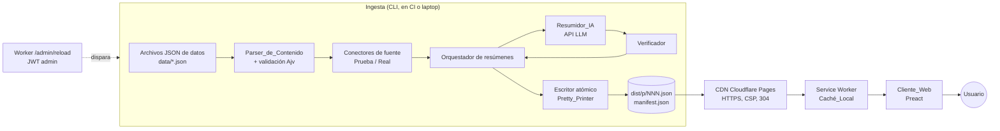
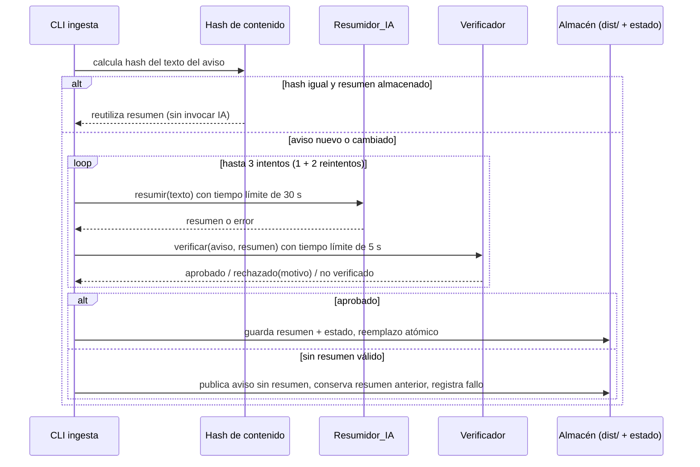
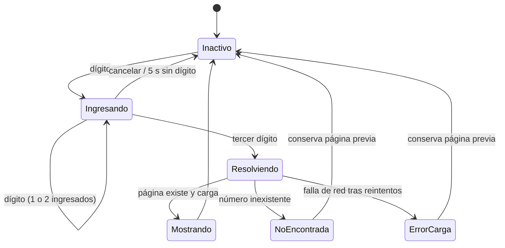

# Design Document

## Overview

Teletexto 2.0 es una PWA estática, servida desde una CDN, que muestra páginas de información pública identificadas por números de tres dígitos (100, 101, 200, 300). El contenido se precalcula como archivos JSON estáticos. Los resúmenes con IA se generan una sola vez, al publicar un aviso, y pasan por un verificador determinista antes de publicarse.

Objetivos de diseño, en orden de prioridad:

1. **Veracidad**: ningún resumen llega al usuario si el Verificador no lo aprueba (Requisitos 10, 11).
2. **Funcionamiento con red mala o sin red**: carga inicial de 150 KB o menos, páginas de 20 KB o menos, service worker con caché local (Requisitos 7, 13).
3. **Costo y alcance**: dos personas, 15 días, USD 20 al mes o menos (Requisitos 15, 18).
4. **Crecimiento posterior**: agregar páginas y fuentes con datos y configuración, no con código (Requisito 16).

### Decisiones tecnológicas y compromisos

| Decisión | Elección | Alternativas descartadas | Razón y compromiso |
|---|---|---|---|
| Cliente | PWA con **Preact + TypeScript + Vite** | React (más pesado, unos 40 KB); JS plano (más código de interfaz propio) | Preact pesa unos 4 KB y permite componentes. Cabe en el presupuesto de 150 KB. Tiene menos ecosistema que React, y para este MVP alcanza. |
| Estilo | CSS propio, fuente monoespaciada del sistema | Frameworks CSS; fuentes web | Evita descargar fuentes. El aspecto teletexto se logra con cuadrícula CSS y una paleta fija. |
| Servicio_Contenido | **Archivos JSON estáticos** generados en build y servidos por CDN (`/p/100.json`, etc.) | API con servidor siempre activo | Cumple el Requisito 15.2 (sin cómputo por solicitud) y el 16.5 (sin estado). El costo es que los cambios se publican por build, no al instante. |
| Hosting y CDN | **Cloudflare Pages** | Netlify, Vercel, S3 + CloudFront | Nivel gratuito, HTTPS automático, archivo `_headers` para CSP y HSTS, ETag y 304 en la CDN. Hay dependencia de un proveedor, pero los archivos son portables. |
| Ingesta | **CLI Node** (`tools/ingest`) que ejecuta Parser, Resumidor y Verificador, y escribe JSON a `dist/` | Función serverless por solicitud | Corre en CI o en la laptop. No hay cómputo en la consulta. Reemplaza el "panel de administración" (fuera de alcance). |
| Rate limit y autenticación de escritura | **Cloudflare WAF Rate Limiting** (60 solicitudes por 60 s por IP) y un **Worker mínimo** `/admin/*` protegido con token JWT firmado | Servidor propio | El Worker solo atiende recargas de contenido. En una arquitectura de solo lectura, el Requisito 14.3 aplica a este único punto de escritura. |
| IA | LLM por API (por ejemplo Claude Haiku o Gemini Flash) invocado **solo desde el CLI de ingesta** | Invocar al LLM desde el navegador | La clave nunca está en el cliente (Requisito 14.4 y 14.5). Un resumen por aviso cuesta centavos. |
| Verificador | **Determinista** (extractor de Datos_Críticos con expresiones regulares y léxicos), sin LLM | Un segundo LLM como juez | Es reproducible, se prueba con propiedades y no cuesta. Su límite es que solo detecta tipos de datos que sabe extraer. Se compensa con la política de rechazar ante la duda. |
| Caché offline | **Service worker escrito a mano** (unos 150 líneas) con Cache Storage | Workbox | Menos peso y control total de la política de reintentos y de la fecha de sincronización. |
| Pruebas | **Vitest + fast-check** (propiedades), Playwright (extremo a extremo), Lighthouse CI (rendimiento) | Jest | Misma cadena que Vite. fast-check es una biblioteca madura de pruebas basadas en propiedades. |
| Validación de esquema | **Ajv** con JSON Schema | Validación manual | Mensajes de error con campo y regla (Requisito 12.3). |

## Architecture



### Flujo de publicación de un aviso



### Flujo de navegación en el cliente



### Decisiones clave

- **Un archivo por página**: `p/NNN.json` permite validación de caché por página (ETag, 304 con cuerpo vacío) y sincronización independiente (Requisitos 7.6, 13.5).
- **Metadatos dentro de cada archivo de página**: guardar página y metadatos en un solo archivo hace atómico el almacenamiento (Requisito 8.6). El reemplazo del conjunto se hace escribiendo en `dist.tmp/` y renombrando (Requisito 12.2).
- **Fechas en UTC ISO 8601 en el servidor, hora de Lima solo en el cliente**: Perú no usa horario de verano, por lo que el desfase fijo UTC-5 es seguro (Requisito 8.2).
- **Sin estado en el servidor**: toda respuesta es un archivo estático, cualquier instancia o nodo de la CDN responde igual (Requisitos 16.5, 16.6).
- **Etiqueta de prueba como dato, no como código**: cada registro lleva `esDatoDePrueba`; el cliente decide por registro (Requisito 9).

## Components and Interfaces

### Cliente_Web (`apps/web`)

| Módulo | Responsabilidad | Interfaz principal |
|---|---|---|
| `nav/entryBuffer` | Máquina de estados de dígitos (puro) | `push(state, digit, now) -> state`, `cancel(state)`, `tick(state, now) -> state`, `display(state) -> string` (por ejemplo `"1_ _"` con marcador) |
| `nav/router` | Resolver número a URL y viceversa | `pageToUrl(n) -> "/p/101"`, `urlToPage(path) -> number \| null`, `isValidPageNumber(n)` |
| `nav/history` | Historial de sesión | `visit(h, n)`, `back(h) -> {history, page}` (sin cambio si no hay anterior) |
| `data/pageLoader` | Cargar página con reintentos y respaldo | `loadPage(n, deps) -> Result<Page, LoadError>`; reintenta con esperas de 1, 2 y 4 s |
| `data/retry` | Política de reintentos (pura) | `backoffSchedule(attempts) -> number[]` |
| `format/dates` | Formato de fechas | `formatLima(iso: string): string` (`DD/MM/AAAA HH:mm`) o `"No disponible"` |
| `format/money` | Formato de moneda | `formatSoles(n: number): string` (`"S/ 2.50"`) |
| `format/sanitize` | Escape de texto externo | `escapeText(s: string): string` |
| `pages/Portada`, `Alertas`, `Precios`, `Salud` | Vistas | Reciben un `Page` ya validado |
| `pages/alertSort` | Orden y fusión de alertas | `sortAlerts(a[])`, `mergeSources(snapshotSenamhi, snapshotIndeci)` |
| `pages/pricesView` | Filtro y paginación de precios | `filterByProduct(rows, p)`, `paginate(rows, 20)` |
| `pages/healthView` | Orden, vigencia y paginación | `sortByStart`, `activeCampaigns(items, today)`, `paginate(items, 20)` |
| `a11y/contrast` | Cálculo de contraste WCAG | `contrastRatio(fg, bg) -> number` (usado en pruebas de la paleta) |

El Cliente_Web solo consume `/p/NNN.json` y `/manifest.json` del mismo origen. No hay llamada alguna al Resumidor_IA.

### Service Worker (`apps/web/sw.ts`)

- `install`: precaché de la aplicación base (HTML, JS, CSS) para llegar a 150 KB o menos.
- `sync(pages)`: al detectar conexión (`online`) o al iniciar con red, descarga 100, 101, 200 y 300 con tiempo límite de 10 s. Guarda cada página con `{ contenido, syncedAt }`. En fallo, **no toca** la versión anterior y reintenta hasta 3 veces con 30 s o más entre intentos. Tras el tercer fallo, deja `syncedAt` intacto y emite el aviso "no se pudo actualizar".
- `fetch`: política *cache-first con revalidación* para páginas. Sin red responde desde caché en menos de 1 s. La actualización en segundo plano **no reemplaza** lo que se está mostrando; el cliente solo ve el contenido nuevo en la siguiente navegación.
- Contrato con la interfaz: `getCacheStatus(n) -> {cached: boolean, syncedAt?: string}`, `listCachedPages() -> number[]`.

### Servicio_Contenido (generado en build, `tools/ingest`)

```ts
interface ConectorFuente {
  id: "senamhi" | "indeci" | "midagri" | "minsa";
  leer(opts: { timeoutMs: number }): Promise<RegistroCrudo[]>; // rechaza si supera 10 s
}
```

- `ConectorPrueba` (MVP) lee `data/prueba/*.json`. `ConectorReal` (futuro) implementa la misma interfaz. El cliente no cambia (Requisito 12.6).
- Si un conector falla o excede 10 s: se registra `{fuente, error}`, se conserva el último contenido válido y se devuelve el error a quien lanzó la carga (Requisito 12.7).

```ts
// Parser_de_Contenido y Pretty_Printer
parsePage(text: string, fileName: string): Result<Page, ParseError>;
printPage(page: Page): string; // JSON UTF-8, claves en orden fijo, sangría de 2 espacios, "\n" final
loadAll(files: FileInput[]): Result<ContentSet, ParseError[]>; // todo o nada
validatePageConfig(cfgs: PageConfig[]): Result<void, ConfigError>; // 100..999, sin duplicados
```

`ParseError = { archivo: string; campo?: string; causa?: string; regla: string }`. Se rechaza un archivo vacío, mayor a 1 MB, que no sea JSON o que incumpla el esquema.

### Orquestador de resúmenes

```ts
interface Resumidor { resumir(aviso: AvisoOficial, signal: AbortSignal): Promise<string>; }
interface Verificador { verificar(aviso: AvisoOficial, resumen: string): ResultadoVerificacion; }

type ResultadoVerificacion =
  | { estado: "aprobado" }
  | { estado: "rechazado"; motivo: MotivoRechazo }
  | { estado: "no_verificado"; motivo: string };

function publicarResumen(aviso, previo: ResumenGuardado | undefined, deps): ResumenGuardado | undefined;
```

Reglas del orquestador:

1. Si `hashTexto(aviso)` coincide con el `hashFuente` del resumen guardado, **no invoca** al Resumidor (Requisitos 10.5, 15.4).
2. Hasta 1 intento inicial más 2 reintentos, con tiempo límite de 30 s por intento (Requisitos 10.6, 15.5).
3. Un intento es válido si el resumen tiene entre 1 y 60 palabras **y** el Verificador devuelve `aprobado`.
4. Si ningún intento es válido: se publica el aviso sin resumen y se conserva el resumen anterior solo si el hash no cambió. Si el texto cambió, el resumen anterior ya no corresponde y se omite (ver Error Handling). Se registra el fallo y no se vuelve a invocar hasta la próxima actualización.

### Verificador (`packages/verifier`)

Extrae Datos_Críticos de un texto como conjuntos normalizados:

```ts
type DatoCritico =
  | { tipo: "cifra"; valor: string; unidad?: string }
  | { tipo: "fecha"; valor: string }        // ISO "AAAA-MM-DD"
  | { tipo: "hora"; valor: string }         // "HH:mm"
  | { tipo: "lugar"; valor: string }        // normalizado, del gazetteer
  | { tipo: "nivel"; valor: string };       // del léxico de niveles de alerta

extraerCriticos(texto: string): DatoCritico[];
```

Reglas:

- **Añadidos**: todo dato del resumen debe estar en el conjunto del aviso. Si no, se rechaza con motivo `añadido:<tipo>`.
- **Modificados**: una cifra o fecha del resumen con el mismo contexto que una del aviso pero otro valor, unidad, signo, día, mes o año se rechaza con `modificado:<tipo>`. Como el conjunto del resumen debe ser subconjunto exacto, un valor distinto aparece como dato no presente. El motivo `modificado` se asigna cuando existe un dato del aviso del mismo tipo con la misma unidad o contexto.
- **Omisiones**: cada recomendación del aviso tiene un `clave` canónico (campo `recomendaciones[].clave`, por ejemplo `"abrigar-ninos"`) y una lista de `frases` aceptadas, normalizadas. El resumen debe contener al menos una frase de cada recomendación. Si falta alguna, se rechaza con `omision:recomendacion`.
- **Plazo**: la verificación usa un límite de 5 s. Si se excede o lanza error, devuelve `no_verificado`.
- **Política ante la duda**: si el extractor no puede interpretar un token numérico, lo trata como cifra y exige que aparezca igual en el aviso.

El registro de verificación se guarda como `{ estado, motivo?(≤500), verificadoEn (UTC, segundos) }`.

### Worker de administración (`workers/admin`)

Único punto de escritura. `POST /admin/reload` exige `Authorization: Bearer <JWT>` con `rol=admin` y `exp` vigente. Sin credencial o con credencial inválida responde 401. Con rol distinto de admin responde 403. En ambos casos no cambia nada y registra `{timestamp, ip, recurso}`. Si es válida, dispara el workflow de ingesta en CI. Los secretos (clave del LLM, clave de verificación JWT) viven en variables de entorno del CI y del Worker (Requisito 14.4).

### Cabeceras de seguridad (`public/_headers`)

```
/*
  Content-Security-Policy: default-src 'self'; script-src 'self'; style-src 'self'; img-src 'self' data:; connect-src 'self'; frame-ancestors 'none'; base-uri 'none'
  X-Content-Type-Options: nosniff
  X-Frame-Options: DENY
  Strict-Transport-Security: max-age=63072000; includeSubDomains
```

La redirección HTTP a HTTPS se activa con "Always Use HTTPS" de Cloudflare (Requisito 14.2). El rate limit de 60/60 s devuelve 429 con la cabecera `Retry-After`.

## Data Models

### Esquema de página (JSON Schema, resumido)

```json
{
  "$id": "teletexto/page.schema.json",
  "type": "object",
  "required": ["numero", "titulo", "tipo", "metadatos", "esDatoDePrueba", "registros"],
  "additionalProperties": false,
  "properties": {
    "numero": { "type": "integer", "minimum": 100, "maximum": 999 },
    "titulo": { "type": "string", "minLength": 1, "maxLength": 40 },
    "tipo": { "enum": ["portada", "alertas", "precios", "salud"] },
    "esDatoDePrueba": { "type": "boolean" },
    "metadatos": {
      "type": "object",
      "required": ["fuente", "publicadoEn", "actualizadoEn"],
      "properties": {
        "fuente": { "enum": ["SENAMHI", "INDECI", "MIDAGRI", "MINSA", "VARIAS"] },
        "publicadoEn": { "type": "string", "format": "date-time" },
        "actualizadoEn": { "type": "string", "format": "date-time" }
      }
    },
    "registros": { "type": "array", "items": { "oneOf": [
      { "$ref": "#/$defs/entradaMenu" }, { "$ref": "#/$defs/alerta" },
      { "$ref": "#/$defs/precio" },      { "$ref": "#/$defs/campana" } ] } }
  }
}
```

### Tipos TypeScript

```ts
type PageNumber = number; // entero 100..999

interface Metadatos { fuente: Fuente | "VARIAS"; publicadoEn: string; actualizadoEn: string } // UTC ISO 8601

interface Page {
  numero: PageNumber; titulo: string; tipo: "portada" | "alertas" | "precios" | "salud";
  esDatoDePrueba: boolean;           // nunca nulo; ausente o inválido => true al cargar
  metadatos: Metadatos;
  registros: Registro[];
}

interface Base { id: string; esDatoDePrueba: boolean }   // por registro (Requisitos 9.2, 9.6)

interface EntradaMenu extends Base { numero: PageNumber; nombre: string /* ≤40 */ }

interface Alerta extends Base {
  titulo: string;                // ≤100
  nivel: "ROJO" | "NARANJA" | "AMARILLO" | "VERDE"; // con orden de severidad
  zona: string; fuente: "SENAMHI" | "INDECI";
  publicadoEn: string;
  aviso: AvisoOficial;
}

interface AvisoOficial {
  id: string; textoOriginal: string;
  urlOriginal?: string; referencia?: string;   // ≤200 si es referencia textual
  recomendaciones: { clave: string; frases: string[] }[];
  resumen?: {
    texto: string;               // 1..60 palabras
    hashFuente: string;          // sha-256 del textoOriginal normalizado
    verificacion: { estado: "aprobado"; verificadoEn: string };
  };
  // rechazado / no_verificado se guardan en el registro de ingesta (logs/), no en el JSON público
}

interface Precio extends Base {
  producto: string; mercado: string; unidad: string;
  precioCentimos: number | null;  // entero en céntimos; null => "Sin dato"
  fecha: string;
}

interface Campana extends Base {
  titulo: string /* ≤80 */; descripcion: string /* ≤300 */;
  inicio: string; fin: string;     // fecha ISO; se muestran DD/MM/AAAA
  ubicacion: string /* ≤100 */; fuente: "MINSA";
  aviso?: AvisoOficial;
}
```

- Los precios se almacenan en **céntimos enteros** para evitar errores de coma flotante. `formatSoles(250)` devuelve `"S/ 2.50"`.
- El registro de ingesta (`logs/verificacion.jsonl`) conserva `{avisoId, estado, motivo?, verificadoEn}` para auditoría. Los estados `rechazado` y `no_verificado` no se publican.

### Manifiesto

`manifest.json`: `{ version, generadoEn, paginas: [{numero, titulo, ruta, hash, bytes}] }`. El cliente lo usa para saber qué páginas existen (Requisito 16.2) y para la lista de páginas sin conexión (Requisito 7.4).

### Estado del service worker

Clave en Cache Storage: `/p/NNN.json`. Metadatos en IndexedDB: `{numero, syncedAt, intentosFallidos}`.

### Presupuesto de tamaño

| Elemento | Límite | Estimado |
|---|---|---|
| Carga inicial (HTML+CSS+JS comprimidos) | 150 KB | Preact 4 KB + app 35 KB + CSS 8 KB, unos 50 KB |
| Página `p/NNN.json` comprimida | 20 KB | 2 a 8 KB |
| Imágenes | 10 KB por imagen | Solo iconos SVG en línea |


## Correctness Properties

*A property is a characteristic or behavior that should hold true across all valid executions of a system-essentially, a formal statement about what the system should do. Properties serve as the bridge between human-readable specifications and machine-verifiable correctness guarantees.*

Reflexión sobre redundancia: se fusionaron las propiedades de render de alertas (2.1, 2.3, 2.5, 17.6), de etiqueta de prueba (1.4, 9.1, 9.4, 9.5, 9.6), de reintentos del Resumidor (10.6, 11.6, 15.5) y de resumen verificado (10.3, 11.2, 11.4, 11.9). Se unificaron las propiedades de URL y de página inexistente con la de manifiesto (5.4, 5.11-5.13, 6.8, 16.2). La paginación de 20 elementos (3.1, 4.1, 4.2) se expresa una sola vez.

### Property 1: Ida y vuelta del contenido (parser e impresor)

*Para toda* Página válida, `parsePage(printPage(p))` produce un objeto igual a `p` campo por campo (incluidos los metadatos), y `printPage(parsePage(printPage(p)))` es idéntico a `printPage(p)`. La salida es UTF-8 y cumple el esquema.

**Validates: Requirements 12.4, 12.5, 8.7**

### Property 2: Archivos inválidos se rechazan completos y no alteran el contenido anterior

*Para todo* conjunto de archivos que contenga al menos un archivo vacío, de más de 1 MB, que no sea JSON o que incumpla el esquema, `loadAll` devuelve un error que indica el nombre del archivo, el campo o la causa y la regla incumplida, y el contenido publicado previamente permanece idéntico. *Para todo* conjunto válido, el contenido nuevo reemplaza al anterior por completo, nunca de forma parcial.

**Validates: Requirements 12.1, 12.2, 12.3, 8.6**

### Property 3: Configuración de páginas válida

*Para toda* lista de configuraciones de página, si algún número está duplicado o fuera de 100 a 999, `validatePageConfig` rechaza la lista con un motivo y las páginas existentes no cambian. Si todos son únicos y están en el rango, se aceptan y el cliente resuelve cada número agregado sin cambios en el código de navegación.

**Validates: Requirements 16.2, 16.3**

### Property 4: Dato de prueba por defecto

*Para todo* registro cargado cuyo atributo `esDatoDePrueba` esté ausente o no sea booleano, el sistema lo trata como `true`. Tras la carga, ningún registro tiene el atributo nulo o ausente.

**Validates: Requirements 9.2, 9.3**

### Property 5: Etiqueta de prueba

*Para toda* página y todo resumen cuyo contenido sea Dato_de_Prueba, el render muestra el texto exacto "DATOS DE PRUEBA - NO OFICIAL" como primera línea visible, y el render desde la Caché_Local es idéntico al render desde la red en texto y posición. *Para todo* registro con `esDatoDePrueba = false`, la etiqueta no aparece en él, y *para todo* registro con `true` aparece.

**Validates: Requirements 1.4, 9.1, 9.4, 9.5, 9.6**

### Property 6: Ida y vuelta entre número de página y URL

*Para todo* número entero de 100 a 999, `urlToPage(pageToUrl(n))` es igual a `n`. *Para toda* ruta que no corresponda a un número de página del manifiesto, `urlToPage` o la resolución devuelve "no encontrada".

**Validates: Requirements 5.11, 5.12, 5.13**

### Property 7: Resolución de número de página

*Para todo* manifiesto de páginas y todo número de tres dígitos ingresado, si el número está en el manifiesto el resultado es mostrar esa página, y si no, el resultado es "Página no encontrada" con la opción de volver a la Portada y la página mostrada antes de la entrada se conserva sin cambios. Ingresar 100 siempre lleva a la Portada.

**Validates: Requirements 5.2, 5.3, 5.4, 5.6, 6.7, 6.8**

### Property 8: Búfer de dígitos

*Para toda* secuencia de eventos de dígito, cancelación y paso del tiempo, el búfer nunca supera tres dígitos, con uno o dos dígitos la pantalla muestra los dígitos ingresados con marcadores en las posiciones faltantes, y tras cancelar o tras 5 s sin dígito nuevo el búfer queda vacío y se muestra el número de la página actual. Al llegar el tercer dígito se emite exactamente una solicitud de resolución.

**Validates: Requirements 5.9, 5.10**

### Property 9: Historial de sesión

*Para toda* secuencia de visitas a páginas, "Atrás" muestra la página visitada inmediatamente antes de la actual. Si no existe página anterior, la página actual y el historial no cambian.

**Validates: Requirements 5.7, 5.8**

### Property 10: Política de reintentos de red

*Para toda* operación de red que falle k veces seguidas, el cargador espera 1 s, 2 s y 4 s entre intentos, realiza como máximo 4 intentos en total y devuelve éxito en cuanto uno funcione. Si los 3 reintentos fallan, devuelve la versión de la Caché_Local con la indicación de contenido desactualizado si existe, o el error de "sin conexión ni contenido guardado" con reintento manual si no existe.

**Validates: Requirements 13.6, 13.7, 13.8, 5.5**

### Property 11: Sincronización conserva la última versión buena

*Para toda* secuencia de resultados de sincronización (éxito, error de red, respuesta inválida, tiempo de espera) de una página, el contenido y la fecha `syncedAt` guardados cambian solo con un éxito y toman el valor de esa respuesta. Con 3 reintentos fallidos, el contenido y `syncedAt` permanecen iguales y se emite el aviso de que no se pudo actualizar. Una actualización en segundo plano no cambia el contenido que se está mostrando.

**Validates: Requirements 7.5, 7.6, 7.7**

### Property 12: Consulta sin conexión

*Para todo* subconjunto de páginas en la Caché_Local y toda solicitud sin conexión, si la página está en el subconjunto se muestra su contenido guardado con el indicador de modo sin conexión y su `syncedAt` formateado, y si no está se muestra el mensaje "no sincronizada" con la lista de páginas disponibles exactamente igual al subconjunto.

**Validates: Requirements 7.2, 7.3, 7.4**

### Property 13: Formato de fechas

*Para todo* instante UTC válido, `formatLima` produce `DD/MM/AAAA HH:mm` en reloj de 24 horas con la hora de UTC menos 5 horas, e incluye el cambio de día, mes y año correcto en los límites. *Para toda* cadena vacía o que no sea una fecha válida, produce "No disponible".

**Validates: Requirements 8.2, 8.3, 7.3, 4.4**

### Property 14: Metadatos y enlace al original

*Para toda* página, el render muestra la fuente, la fecha de publicación y la de actualización, y el DOM los expone en el orden número de página, título y metadatos. Cada campo ausente o inválido se muestra como "No disponible" sin afectar a los demás. *Para todo* aviso con URL, el enlace se abre en pestaña nueva. Si solo tiene referencia, se muestra el texto de la referencia (200 caracteres o menos). Si no tiene ninguna, se muestra "No disponible".

**Validates: Requirements 8.1, 8.3, 8.4, 8.5, 17.4**

### Property 15: Formato de moneda

*Para todo* precio entero en céntimos no negativo, `formatSoles` produce una cadena que cumple `^S/ \d+\.\d{2}$`, y al interpretar el número otra vez se recupera el valor original.

**Validates: Requirements 3.2**

### Property 16: Filtro y precios sin dato

*Para toda* lista de registros de precios y todo producto, el filtro devuelve exactamente los registros cuyo producto coincide, ni más ni menos. Si el resultado es vacío, se muestra el mensaje de "sin registros" y el filtro seguirá aplicado. *Para todo* registro con precio nulo, la celda de precio muestra "Sin dato" y ningún otro valor.

**Validates: Requirements 3.3, 3.4, 3.5**

### Property 17: Orden de alertas y fusión de fuentes

*Para toda* lista de alertas, `sortAlerts` devuelve una permutación de la lista ordenada por severidad descendente y, dentro de cada nivel, por fecha de publicación descendente. *Para toda* combinación de disponibilidad de SENAMHI e INDECI, `mergeSources` muestra las alertas de las fuentes disponibles y nombra a cada fuente no disponible.

**Validates: Requirements 2.2, 2.7**

### Property 18: Render de alertas

*Para toda* alerta, el render incluye título, texto del nivel, zona y nombre de la fuente (SENAMHI o INDECI), un icono y una etiqueta de texto distintos por cada nivel, y, si el nivel es el máximo de la escala, un destacado que además incluye el texto del nivel. La lista no supera 50 alertas.

**Validates: Requirements 2.1, 2.3, 2.5, 17.6**

### Property 19: Orden, vigencia y paginación de listas

*Para toda* lista de registros (precios, campañas) y todo tamaño de página de 20, `paginate` produce páginas de 20 elementos o menos cuya concatenación es igual a la lista de entrada, y solo la primera página aparece al abrir. *Para toda* lista de campañas, el orden es por fecha de inicio ascendente, cada elemento muestra "MINSA" y las fechas en `DD/MM/AAAA`. Una campaña está vigente si su fecha de fin es igual o posterior a la fecha actual, y si ninguna lo está se muestra "No hay campañas vigentes".

**Validates: Requirements 3.1, 4.1, 4.2, 4.3, 4.4**

### Property 20: Sanitización de contenido externo

*Para toda* cadena de texto recibida de una fuente, incluidas las que contienen `<script>`, atributos de evento (`onerror=`), comillas y entidades, el contenido mostrado no crea elementos `script` ni atributos `on*` en el DOM, y el texto aparece como texto.

**Validates: Requirements 14.6**

### Property 21: Verificación de resúmenes aprobados

*Para todo* aviso y todo resumen, si el Verificador devuelve `aprobado`, entonces el conjunto de Datos_Críticos del resumen es un subconjunto exacto del conjunto del aviso (mismo valor, unidad y formato) y el resumen contiene al menos una frase aceptada de cada recomendación del aviso. *Para todo* resumen generado a partir de un aviso válido al que se le añade un dato crítico ausente en el aviso, o se le modifica el valor, la unidad, el signo, el día, el mes o el año de una cifra o fecha, el resultado es `rechazado` con el tipo de dato como motivo. *Para todo* resumen al que se le quita una recomendación, el resultado es `rechazado` con motivo de omisión.

**Validates: Requirements 10.3, 11.1, 11.2, 11.3, 11.4, 11.9**

### Property 22: Orquestador de resúmenes

*Para todo* comportamiento del Resumidor (éxito, error, tiempo agotado, resumen fuera de 1 a 60 palabras) y todo resultado del Verificador, el orquestador realiza como máximo 3 invocaciones al Resumidor por aviso. Solo publica un resumen que tiene de 1 a 60 palabras y estado `aprobado`. Si ningún intento cumple, publica el aviso sin resumen, registra el fallo, y no vuelve a invocar al Resumidor para ese aviso hasta que cambie su texto.

**Validates: Requirements 10.2, 10.6, 11.6, 15.5, 18.4**

### Property 23: Idempotencia y conservación del resumen

*Para todo* aviso, publicarlo dos veces con el mismo texto invoca al Resumidor una sola vez en total y deja el mismo resumen almacenado. *Para toda* actualización de aviso con texto distinto, el resumen almacenado anterior se reemplaza solo cuando el nuevo resumen se genera y se aprueba. Mientras tanto, el texto publicado nunca queda emparejado con un resumen de otro texto.

**Validates: Requirements 10.5, 10.8, 15.3, 15.4**

### Property 24: Presentación del resumen frente al original

*Para todo* aviso, si tiene un resumen aprobado, el render muestra el resumen con la etiqueta "Resumen generado con IA" y un enlace al texto original completo en la misma pantalla. Si no tiene resumen o su estado no es `aprobado`, el render muestra el texto original completo, el mensaje "Se muestra el aviso original" cuando corresponde, y ninguna parte de un resumen ni la etiqueta de IA.

**Validates: Requirements 10.4, 10.7, 11.5, 11.7**

### Property 25: Registro de verificación

*Para todo* resultado del Verificador, el registro contiene el estado (`aprobado`, `rechazado` o `no_verificado`), la fecha y hora en UTC con precisión de segundos, y un motivo de 500 caracteres o menos que es obligatorio cuando el estado es `rechazado`.

**Validates: Requirements 11.8**

### Property 26: Autorización de escritura

*Para toda* solicitud de modificación de contenido y toda credencial (ausente, mal formada, firma inválida, expirada, rol distinto de admin, válida de admin), `authorize` devuelve 401 si la credencial falta o no es válida, 403 si es válida pero sin rol de administrador, y permite la operación solo con una credencial válida, vigente y de administrador. En los dos primeros casos el contenido no cambia y se genera un registro con fecha y hora, IP y recurso.

**Validates: Requirements 14.3, 14.10**

## Error Handling

| Situación | Dónde | Comportamiento |
|---|---|---|
| Página seleccionada desde menú no carga | Cliente | Se mantiene la Portada y se muestra "Página no disponible" (1.5) |
| Número inexistente por teclado, URL o entrada | Cliente | "Página no encontrada", acción "Volver a Portada", página previa visible (1.6, 5.4, 5.13) |
| Fallo de red o servidor al cargar una página | Cliente | Reintentos a 1, 2 y 4 s. Luego versión en caché con aviso de posible desactualización, o error con reintento manual (5.5, 13.6-13.8) |
| Datos de alertas, precios o salud no disponibles o con más de 10 s | Cliente | Mensaje de error, datos previos visibles si existen y botón "Reintentar" (2.6, 3.6, 4.5) |
| Una de las dos fuentes de alertas falta | Cliente | Se muestran las alertas de la otra y el nombre de la fuente ausente (2.7) |
| Fecha o metadato ausente o inválido | Cliente | "No disponible" en el campo afectado (8.3) |
| Sin conexión y página no sincronizada | Cliente | Mensaje y lista de páginas disponibles (7.4) |
| Falla de sincronización | Service Worker | Se conserva la versión anterior, 3 reintentos con 30 s o más entre intentos y aviso final (7.6, 7.7) |
| Archivo de datos inválido | Parser | Rechazo completo con archivo, campo y regla. Contenido anterior sin cambios (12.3) |
| Conector no responde en 10 s o falla | Ingesta | Se registra la fuente, se conserva el último contenido válido y se notifica a quien lanzó la carga (12.7) |
| La IA falla, excede 30 s o devuelve más de 60 palabras | Orquestador | Hasta 2 reintentos, luego aviso sin resumen y fallo registrado (10.6, 11.6) |
| Verificador rechaza o no termina en 5 s | Orquestador | El resumen no se publica, el cliente muestra el original, estado `rechazado` o `no_verificado` (11.5) |
| Texto de aviso cambia y no hay resumen nuevo válido | Orquestador | Se publica el aviso nuevo sin resumen. No se conserva un resumen que ya no corresponde al texto |
| Escritura de `dist/` interrumpida | Ingesta | Se escribe en `dist.tmp/` y se renombra al final. Si falla, `dist/` anterior queda intacto (8.6, 12.2) |
| Credencial ausente, inválida o sin rol | Worker admin | 401 o 403, sin cambios y registro del intento (14.10) |
| Más de 60 solicitudes por IP en 60 s | CDN (WAF) | 429 con `Retry-After` (14.8) |
| Texto externo con HTML o scripts | Cliente | Se escapa y se muestra como texto (14.6) |

Limitaciones conocidas del diseño:

- El Verificador solo detecta los tipos de Datos_Críticos que su extractor conoce (cifras, fechas, horas, lugares del gazetteer, niveles del léxico, recomendaciones con `clave`). Ante la duda rechaza. Esto puede descartar resúmenes correctos, lo cual es aceptable porque el respaldo es el texto original.
- El requisito 11.9 exige 100 % de las recomendaciones en un resumen de 60 palabras o menos. Si un aviso tiene más recomendaciones de las que caben, el resumen será rechazado y se mostrará el original. Los avisos de prueba se redactan con 1 a 3 recomendaciones.
- La alta disponibilidad depende de la CDN. El Servicio_Contenido no tiene servidor propio que escalar, y cualquier nodo responde igual (16.4 a 16.6).

## Testing Strategy

### Enfoque dual

- **Pruebas unitarias y de ejemplo**: casos concretos y de borde (Portada con 3 entradas, mensajes de error, sin conexión sin caché, catálogo de textos de interfaz con oraciones de 25 palabras o menos, paleta con contraste de 7:1 o más para texto y 3:1 para foco).
- **Pruebas basadas en propiedades**: las 26 propiedades de la sección anterior, que cubren las entradas generadas.
- **Integración y humo**: tiempos y cabeceras en un entorno de vista previa.

### Pruebas basadas en propiedades

- Biblioteca: **fast-check** con **Vitest**. No se implementa un generador propio de propiedades.
- Mínimo **100 iteraciones** por propiedad (`numRuns: 100`).
- Cada propiedad se implementa con **una sola prueba** y lleva el comentario `Feature: teletexto-2-0, Property N: <texto de la propiedad>`.
- Generadores clave: `arbPage` (páginas válidas con Unicode, ceros iniciales y fechas límite), `arbAviso` (avisos con cifras, fechas, horas, lugares, niveles y recomendaciones), `arbMutacion` (añade, modifica u omite datos críticos), `arbEventosDigitos` (dígitos, cancelaciones y tiempos), `arbResultadosSync`, `arbToken` y `arbHtmlHostil`.
- El tiempo se inyecta como reloj simulado para que las propiedades 8, 10 y 11 sean deterministas. El Resumidor y la red son simulados con fallos aleatorios.
- Las propiedades 1, 2, 21 y 22 son las de mayor valor y deben estar listas antes del día 8 del calendario.

### Pruebas de integración y humo

| Prueba | Herramienta | Requisitos |
|---|---|---|
| Rendimiento con red 2G/3G simulada (carga de página en 5 s o menos, 2 s para Portada) | Lighthouse CI, Playwright | 1.1, 5.2, 5.3, 13.1 |
| Tamaño de carga inicial (150 KB o menos), páginas (20 KB o menos), imágenes (10 KB o menos) | Script de CI sobre `dist/` | 13.2-13.4 |
| Respuesta 304 con cuerpo vacío | Solicitud con `If-None-Match` a vista previa | 13.5 |
| HTTPS, redirección y cabeceras de seguridad | Script contra vista previa | 14.1, 14.2, 14.7 |
| Sin secretos en el repositorio ni el bundle, sin llamadas del navegador a la IA | gitleaks y revisión del bundle | 14.4, 14.5 |
| Límite de 60 solicitudes por minuto con 429 | Prueba corta de carga contra vista previa | 14.8 |
| 1000 usuarios concurrentes con 99 % de éxito | k6 contra vista previa | 16.4 |
| Instalación PWA | Lighthouse PWA | 7.8 |
| Accesibilidad (teclado, foco, zoom 200 %, ARIA) | Playwright + axe-core | 6.2, 6.6, 17.2-17.5 |
| Guion de demostración (100, 101, 200, 300, resumen verificado, página sin red) | Playwright | 18.3 |

### Pruebas que no usan propiedades y por qué

- **Infraestructura (CDN, HTTPS, rate limit, 304)**: el comportamiento no varía con la entrada y se verifica con 1 a 3 ejemplos.
- **Diseño responsivo y estilo teletexto**: pruebas de captura por ancho (320, 600, 1280, 3840 px) y revisión visual.
- **Tiempos de respuesta**: dependen del entorno y se miden con Lighthouse.

### Costo mensual estimado (Requisito 15.6)

Supuestos: 100 000 solicitudes al mes, 40 avisos nuevos o actualizados al mes, 3 intentos de IA como máximo por aviso (120 invocaciones), unos 2 000 tokens por invocación.

| Componente | Plan | USD/mes |
|---|---|---|
| Cloudflare Pages (hosting, CDN, HTTPS) | Gratuito | 0 |
| Cloudflare WAF Rate Limiting | Reglas básicas del plan gratuito | 0 |
| Cloudflare Worker `/admin/reload` | Gratuito (100 000 solicitudes al día) | 0 |
| GitHub Actions (ingesta y pruebas) | Gratuito | 0 |
| API de IA (modelo pequeño, 120 invocaciones, unos 240 000 tokens) | Pago por uso | menos de 1 |
| Dominio propio (opcional) | Anual prorrateado | 1 |
| Reserva para imprevistos | n/a | 5 |
| **Total estimado** | | **menos de 7** |

El total queda por debajo del límite de USD 20. Las cifras de la API de IA deben confirmarse con la tarifa vigente del proveedor elegido antes del lanzamiento.

### Plan de riesgos del calendario

- Días 1 a 3: esquema, Parser, Pretty_Printer y datos de prueba (propiedades 1 a 4).
- Días 4 a 7: Portada, Página 101, navegación y service worker (propiedades 5 a 14, 17, 18).
- Días 8 a 10: Verificador y orquestador (propiedades 21 a 25).
- Días 11 a 13: Páginas 200 y 300, seguridad y accesibilidad.
- Días 14 y 15: pruebas de rendimiento, ensayo de la demostración y documento de costo.

Si hay retraso, se recorta primero lo no obligatorio del Requisito 18.6: el filtro de precios y la paginación de salud, nunca la verificación de resúmenes.
